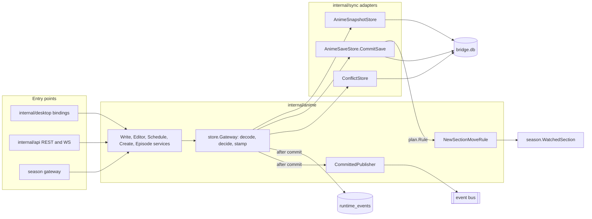

# Anime — overview

The anime context exclusively owns anime state. It validates each change (progress, status, days,
repetitions, cover), encodes the Bridge's own storage format, and runs every save as one SQLite
write transaction that stores the snapshot and its changelog row together. Only after the commit
does it announce the change on the event bus. ADR 008 (`docs/adr/008-legacy-breakup-sqlite-sole-owner.md`)
records why SQLite is the sole owner; nothing reads or writes a Legacy Desktop file.

For the save as a decision tree, read `workflow.md`. For the database conventions the save relies
on (one connection, `InWriteTx`, migrations), read `../../cross-cutting/persistence.md`.

## Responsibility

- Owns: the anime snapshot (`anime_snapshots.snapshot_json`), its version token `modified_at`, the
  name identity `name_key`, the changelog row of every anime save, conflict records for stale
  bases, and the `anime.changed` event.
- Does not own: the season state the Season rule reads (`internal/season`), delivery of changes to
  phones (the WebSocket hub and the sync REST handlers in `internal/api`), or episode files on disk
  (`internal/download`).

## Package map

| Package | Role |
|---|---|
| `internal/anime` | Application services: `WriteService`, `EditorService`, `ScheduleService`, `CreateService`, `EpisodeService`, the save rule and the committed publisher |
| `internal/anime/store` | The `Gateway` (decode, decide, stamp, call the save store), the storage codec (`AnimeRaw`, `Mapper`) and the save port types (`save.go`) |
| `internal/anime/domain` | The English aggregate `domain.Anime` and its value rules |
| `internal/sync` (adapters) | `AnimeSaveStore` (the save transaction), `AnimeSnapshotStore` (reads), `animeNameKey`, `ChangelogStore`, `ConflictStore` |
| `internal/persistence` | `InWriteTx`, `InTx` and the `Querier` the save runs on |
| `internal/season` | `WatchedSection`, the target of the Season "Ver hoy → Visto" rule |

Main files of the write path:

| File | Holds |
|---|---|
| `internal/anime/write_service.go` | `WriteService`, `WriteServiceDeps`, `PatchAnime`, `ApplyBatch`, `publishCommitted` |
| `internal/anime/editor_service.go`, `schedule_service.go`, `create_service.go` | Editor save and deactivate, the schedule board, single and batch creates |
| `internal/anime/store_gateway_config.go` | `newStoreGatewayConfig` and `logRecordedChangelog` |
| `internal/anime/save_store.go`, `save_rule.go` | Aliases of the store port types, and `NewSectionMoveRule` |
| `internal/anime/committed_publisher.go`, `committed_change.go` | `CommittedPublisher` and `newAnimeChangedEvent` |
| `internal/anime/store/gateway.go`, `gateway_write_helpers.go` | `Create`, `Update`, `UpdateRaw`, `ApplyBatch`, `decide`, `stampSingle`, `recordConflict` |
| `internal/anime/store/save.go` | `SaveStore`, `SavePlan`, `SaveItem`, `SaveDecision`, `SaveRule`, `CommittedChange` |
| `internal/sync/anime_save_store.go` | `AnimeSaveStore.CommitSave` and the in-transaction steps |
| `internal/sync/anime_name_key.go` | `animeNameKey` and the `name_key` column migration |
| `internal/sync/changelog_store.go` | `recordPendingTx`, the changelog insert used inside the save |

## Ports and adapters

The application services build a `store.Gateway` per call (`WriteService.gateway`,
`write_service.go`) over the config `newStoreGatewayConfig` assembles. The composition root,
`internal/desktop/app_runtime_services.go` (`configureAnimeApplicationServices`,
`newAnimeWriteDeps`), wires the same dependencies into every write service.

| Port | Adapter | Used for |
|---|---|---|
| `store.SaveStore` (`store/save.go`) | `sync.AnimeSaveStore` (`anime_save_store.go`), handed out by `AnimeSnapshotStore.SaveStore` (`anime_snapshot_store.go`) | The one save transaction |
| `GatewayConfig.LoadSnapshot`, `ListSnapshots` | `sync.AnimeSnapshotStore` | Reads outside a save |
| `GatewayConfig.Conflicts` | `sync.ConflictStore` | The conflict row of a stale single save |
| `store.SaveRule` (`store/save.go`) | `anime.NewSectionMoveRule(season.WatchedSection)` | Rewriting an applied snapshot inside the save |
| `CommittedPublisher` | `busCommittedPublisher` over the shared bus (`internal/desktop/app_defaults.go`) | Publishing `anime.changed` after the commit |
| `WriteServiceDeps.Logger` | shared logger | The `sync.changelog` row in `runtime_events` |

## Events

- `anime.changed` (`events.AnimeChangedEvent`, `internal/events/event.go`) is published once per
  changed anime, after the commit, by `newAnimeChangedEvent` (`committed_change.go`). Its
  `EventID` and `CorrelationID` both equal the changelog row's `source_event_id`. It carries the
  full snapshot (`Payload`), `ChangeType` (`create` or `update`) and `ChangedFields`, both derived
  inside the save transaction.
- Subscribers: the realtime hub that fans it out to phones (`configureRealtimeHub`,
  `internal/desktop/app_runtime_services.go`) and the desktop frontend bridge
  (`registerAnimeRuntimeEventBridge`, `internal/desktop/app_startup_runtime.go`).
- Before publishing, `logRecordedChangelog` (`store_gateway_config.go`) writes one
  `runtime_events` row with `event_type` `sync.changelog`, `entity_id` the anime, and
  `sourceEventId`, `changeType`, `changedFields` in its metadata. Activity reads it as a step of
  the change (`internal/observability/activityread/change_context.go`, by entity and time range).

## Storage

`anime_snapshots` (`animeSnapshotsDDL`, `internal/sync/schema.go`):

| Column | Meaning |
|---|---|
| `anime_id` | Primary key, the snapshot's `id` |
| `snapshot_json` | The canonical snapshot in the Bridge storage format |
| `snapshot_hash` | SHA-256 of `snapshot_json` |
| `modified_at` | The version token, in epoch milliseconds, stamped by every applied save |
| `name_key` | Plain `TEXT` computed in Go by `animeNameKey`; unique index `idx_anime_snapshots_name_key` |
| `schedule_day_migrated_at`, `vocabulary_migrated_at` | Markers of one-shot upgrade migrations |

`changelog` (`changelogDDL`, same file) gets one row per changed anime inside the save:
`anime_id`, `change_type`, `changed_fields_json`, `snapshot_json` (the stored snapshot, already
rewritten by the Season rule), `source_event_id` (unique when not NULL), `status` (`pending`) and
`changed_at_ms` (raised to one past the anime's last row by `pastLastRow`, `changelog_store.go`).

`conflicts` holds `local_snapshot_json` and `remote_snapshot_json` of a stale single save.

### The snapshot format

- `snapshot_json` keeps the historical shape of a NeDB document (one flat object per anime, with
  `days[]`, `repetitions[]`, `cover{}`), but it is the Bridge's own format, not a channel to any
  other app. Keys are English (`id`, `name`, `episodesWatched`, `status`, `active`, `days`, …) and
  dates are plain epoch milliseconds since the one-shot `internal/sync/vocabulary_migration.go`.
- `AnimeRaw` (`internal/anime/store/wire.go`) is a lossless envelope: `id`, `name` and
  `episodesWatched` are typed, everything else stays in `extraFields` and is written through pointer
  setters, so a Go zero value never overwrites an absent field or an explicit `null`. Unknown keys
  survive byte for byte.
- `episodesWatched` is fractional (`float64`); the domain accepts steps of ±1 and ±0.5
  (`internal/anime/episode_service.go`).
- `active` is tri-state (`domain.TriStateTrue`, `TriStateFalse`, `TriStateAbsent`). Deletion is
  logical: `active == false` and `deletedAt != nil` (`store.IsSoftDeleted`,
  `internal/anime/store/projection.go`). A row is never removed from `anime_snapshots`.

## Invariants

- **One transaction per save.** A single save or a batch is one `persistence.InWriteTx`
  (`BEGIN IMMEDIATE`). A failing item, rule, upsert or changelog insert rolls back everything.
- **One changelog row and one event per changed anime**, sharing one event id, the event only
  after the commit. `CommittedPublisher` is the only production path to the bus.
- **Unique names.** `animeNameKey` folds ASCII case and surrounding U+0020 spaces; the unique
  index rejects a second anime with the same key. `tools/checkarchitecture/namekey.go` rejects any
  production SQL literal that writes `anime_snapshots` without `name_key`.
- **OCC on `modified_at`.** An explicit base that differs from the stored token is a conflict:
  nothing is written, the conflict is recorded after the transaction, and the winning token is
  returned.
- **Observe-only OCC for base-less writes.** A write without a base (`Base == nil`, `decide` in
  `gateway_write_helpers.go`) is never a conflict: it is last-write-wins. Only explicit stale bases
  are enforced.
- **Monotonic tokens.** Every applied save stamps a token strictly past the stored one
  (`workflow.md`, section 4).
- **No call leaves the transaction's connection.** Code inside the save, the Season rule included,
  uses only the `Querier` it is handed.

## Entry points

| Caller | Service method | Trigger |
|---|---|---|
| `internal/desktop/app_runtime_editor.go` | `EditorService.Save`, `Deactivate`, `ScheduleService.Apply` | The Editor and the schedule board |
| `internal/desktop/app_library_root.go` | `EditorService.Save` | Rewriting folders under a new library root |
| `internal/desktop/app_runtime_create.go` | `CreateService.CreateBatch` | Creating animes (with reflowed neighbours) |
| `internal/desktop/app.go` (`wireEpisodeServiceWithWriter`) | `EpisodeService` over `WriteService.PatchAnime` | Episode +1 / −1 and watch state |
| `internal/api/router.go` | `PATCH /api/animes/:id`, sync reconcile, WS pending patch, all through `newMobileAnimeWriteService` (`app_runtime_services.go`) | Phones |
| `internal/desktop/app_season_anime_gateway.go`, `app_season_availability.go` | `WriteService.PatchAnime`, `CreateService` | Season mode |

## Known drift

- `newAnimeWriteDeps` (`internal/desktop/app_runtime_services.go`) still explains `OCCObserveOnly`
  as a staged-rollout switch. The field is ignored (`WriteServiceDeps`, `write_service.go`):
  base-less writes are always observe-only and explicit stale bases are always enforced.
- `WriteServiceDeps.Notifier` is wired but nothing in `internal/anime` reads it, so a conflict is
  recorded without a notification.
- `WriteServiceDeps.Publisher`, when set, publishes `anime.changed` directly instead of through
  `CommittedPublisher` (`publishCommitted`, `write_service.go`). Production never sets it.
- `logRecordedChangelog` writes its `sync.changelog` row for every committed change, even when
  `recordPendingTx` stored no row because no top-level field changed.
- `NewSectionMoveRule` (`save_rule.go`) passes `time.Now()` to `applyAnimePatch` instead of the
  service clock (`WriteService.SetNow`), so a test clock does not reach the section move.
