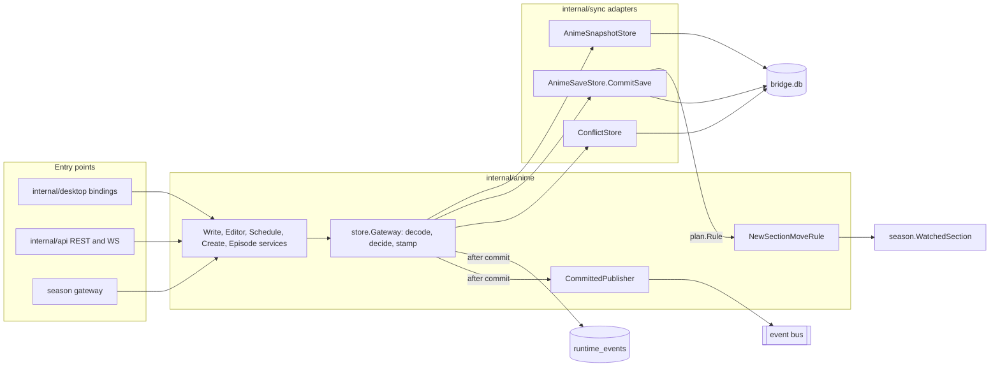
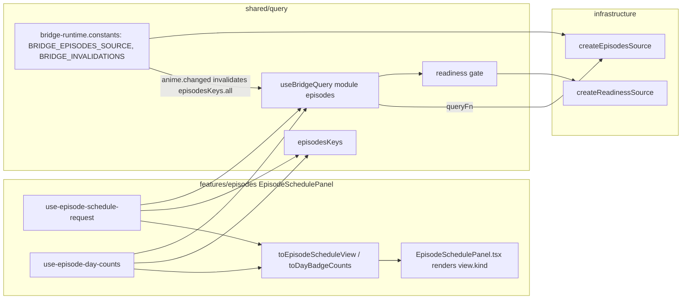
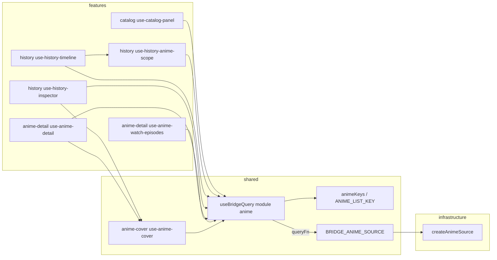

# Anime — overview

The anime context exclusively owns anime state. It validates each change (progress, status, days,
repetitions, cover), encodes the Bridge's own storage format, and runs every save as one SQLite
write transaction that stores the snapshot and its changelog row together. Only after the commit
does it announce the change on the event bus. ADR 008 (`docs/adr/008-legacy-breakup-sqlite-sole-owner.md`)
records why SQLite is the sole owner; nothing reads or writes a Legacy Desktop file.

For the save as a decision tree, read `workflow.md`. For the database conventions the save relies
on (one connection, `InWriteTx`, migrations), read `../../cross-cutting/persistence.md`.

## Responsibility

- Owns: the anime snapshot (`anime_snapshots.snapshot_json`), its version token `modified_at`, the
  name identity `name_key`, the changelog row of every anime save, conflict records for stale
  bases, and the `anime.changed` event.
- Does not own: the season state the Season rule reads (`internal/season`), delivery of changes to
  phones (the WebSocket hub and the sync REST handlers in `internal/api`), or episode files on disk
  (`internal/download`).

## Package map

| Package | Role |
|---|---|
| `internal/anime` | Application services: `WriteService`, `EditorService`, `ScheduleService`, `CreateService`, `EpisodeService`, the save rule and the committed publisher |
| `internal/anime/store` | The `Gateway` (decode, decide, stamp, call the save store), the storage codec (`AnimeRaw`, `Mapper`) and the save port types (`save.go`) |
| `internal/anime/domain` | The English aggregate `domain.Anime` and its value rules |
| `internal/sync` (adapters) | `AnimeSaveStore` (the save transaction), `AnimeSnapshotStore` (reads), `animeNameKey`, `ChangelogStore`, `ConflictStore` |
| `internal/persistence` | `InWriteTx`, `InTx` and the `Querier` the save runs on |
| `internal/season` | `WatchedSection`, the target of the Season "Ver hoy → Visto" rule |

Main files of the write path:

| File | Holds |
|---|---|
| `internal/anime/write_service.go` | `WriteService`, `WriteServiceDeps`, `PatchAnime`, `ApplyBatch`, `publishCommitted` |
| `internal/anime/editor_service.go`, `schedule_service.go`, `create_service.go` | Editor save and deactivate, the schedule board, single and batch creates |
| `internal/anime/store_gateway_config.go` | `newStoreGatewayConfig` and `logRecordedChangelog` |
| `internal/anime/save_store.go`, `save_rule.go` | Aliases of the store port types, and `NewSectionMoveRule` |
| `internal/anime/committed_publisher.go`, `committed_change.go` | `CommittedPublisher` and `newAnimeChangedEvent` |
| `internal/anime/store/gateway.go`, `gateway_write_helpers.go` | `Create`, `Update`, `UpdateRaw`, `ApplyBatch`, `decide`, `stampSingle`, `recordConflict` |
| `internal/anime/store/save.go` | `SaveStore`, `SavePlan`, `SaveItem`, `SaveDecision`, `SaveRule`, `CommittedChange` |
| `internal/sync/anime_save_store.go` | `AnimeSaveStore.CommitSave` and the in-transaction steps |
| `internal/sync/anime_name_key.go` | `animeNameKey` and the `name_key` column migration |
| `internal/sync/changelog_store.go` | `recordPendingTx`, the changelog insert used inside the save |

## Ports and adapters

The application services build a `store.Gateway` per call (`WriteService.gateway`,
`write_service.go`) over the config `newStoreGatewayConfig` assembles. The composition root,
`internal/desktop/app_runtime_services.go` (`configureAnimeApplicationServices`,
`newAnimeWriteDeps`), wires the same dependencies into every write service.

| Port | Adapter | Used for |
|---|---|---|
| `store.SaveStore` (`store/save.go`) | `sync.AnimeSaveStore` (`anime_save_store.go`), handed out by `AnimeSnapshotStore.SaveStore` (`anime_snapshot_store.go`) | The one save transaction |
| `GatewayConfig.LoadSnapshot`, `ListSnapshots` | `sync.AnimeSnapshotStore` | Reads outside a save |
| `GatewayConfig.Conflicts` | `sync.ConflictStore` | The conflict row of a stale single save |
| `store.SaveRule` (`store/save.go`) | `anime.NewSectionMoveRule(season.WatchedSection)` | Rewriting an applied snapshot inside the save |
| `CommittedPublisher` | `busCommittedPublisher` over the shared bus (`internal/desktop/app_defaults.go`) | Publishing `anime.changed` after the commit |
| `WriteServiceDeps.Logger` | shared logger | The `sync.changelog` row in `runtime_events` |

## Readiness and failures

The episodes reads behind Today are served by the `episodes` module (ADR-032,
`../../cross-cutting/async-state.md`). Its lifecycle is reported in `GetReadiness()` and in each
`bridge.readiness` event (`../desktop/overview.md`, "Readiness and failures").

- `GetEpisodeSchedule` and `GetEpisodeDayCounts` read through the `episodes` module handle
  (`appModules.episodes`, `internal/desktop/app_readiness.go`), which `wireEpisodeServiceWithWriter`
  binds before startup marks the module ready. They reject with `unavailable` while the module is
  starting (even when the service is already bound), `failed_precondition` with the startup reason
  after a failed startup, and `internal` when the service fails (ADR-032). Neither answers `[]` in
  place of a failure; a day with nothing scheduled is an empty list, never null.
- The Editor's durations card bindings (`internal/desktop/app_episode_editor.go`:
  `GetEpisodeDurationSection`, `ReanalyzeEpisodeDurations`, `CancelEpisodeReanalysis`,
  `SaveEpisodeDurations`) run through the same handle, over `episodeServices.durations` (the bridge
  database). They reject with `unavailable` / `failed_precondition` like the Today reads, and with
  `internal` when the read, the re-analysis or the save fails (a refused edit stores nothing) or the
  database is missing; no result carries an `error` outcome. Real outcomes stay results:
  re-analysis `ok` or `busy` (another one is running), save `applied` or `no_op`.
- What Today shows in each module state:

| `episodes` state | Today schedule area | Day-tab badges |
|---|---|---|
| `starting` | Skeleton (`role="status"`, three shape-matching rows); no read is called | None |
| `ready` | The rows, or the empty state when the day resolved empty | The loaded counts |
| `failed` | The failure Alert with the module's reason; no read is called | Not shown (the Alert replaces the tabs) |

- A row write that fails (the command rejects) is not a read failure; a `conflict` outcome resolves
  silently and Today reads the schedule again. On a failure Today shows its message in the same
  Alert until the schedule loads again. The episode commands are described in
  `contexts/episodes/overview.md`.

The anime reads behind the Catalog, History and the Detail page are served by the `anime` module the
same way:

- `GetAnimes`, `GetAnimeDetail`, `GetAnimeDetailView`, `GetWatchHistoryPage`,
  `GetAnimeWatchHistoryPage`, `GetAnimeCover` and `PreviewAnimeCover` read through the `anime`
  module handle (`appModules.anime`), which `configureAnimeApplicationServices` binds
  (`bindAnimeModule`). They reject with `unavailable` while the module is starting,
  `failed_precondition` with the startup reason after a failed startup, `not_found` for an unknown
  anime id, `invalid_argument` for an unknown history order and `internal` when a read fails. None
  answers `[]`, `null` or an error-status page in place of a failure. Once ready, a missing or
  unreadable cover is still the placeholder, never a failure.
- The Editor, create and desktop-action bindings run through the same handle
  (`internal/desktop/app_runtime_editor.go`, `app_runtime_create.go`, `app_desktop_actions.go`),
  over `animeServices.editorQuery`, `editorWrite`, `scheduleQuery`, `scheduleWrite`, `createBatch`
  and `query`. They reject with `unavailable` / `failed_precondition` like the reads, and none answers
  an `error` outcome or status: `GetAnimeEditorRecord` is `not_found` for an unknown anime;
  `SaveAnimeEditor` is `invalid_argument` for a patch its DTO conversion rejects; a failed read or
  write (the editor service's own validation included) is `internal`. A failed save or deactivate is
  still recorded as `anime.editor_save_failed` before it is returned. `applied`, `no_op` and
  `conflict` stay result outcomes, and a committed write whose record refresh fails still answers its
  outcome with `details.refreshError`. A failed schedule apply returns its error without a refreshed
  board. The four desktop actions are `not_found` for an unknown anime, `invalid_argument` for an
  anime without a page or folder, and `internal` when the stored value is unsafe or the launch or
  copy fails; nothing is opened or copied while the module is not ready.
- The notification center's "run again" action (`runAnimeAgainIntent`,
  `internal/desktop/app_notification_center.go`) reports a deleted target only for `not_found`; a
  starting module or a failed read is returned as that error.
- What each screen shows in each module state:

| `anime` state | Catalog | History timeline and inspector | Detail page and its episode lists |
|---|---|---|---|
| `starting` | Skeleton; no read is called | Skeletons; no read is called | Skeleton; no read is called |
| `ready` | The anime, or the empty state when the catalog is empty | The rows, the filtered-empty or the empty state; the inspector's content | The detail, or "Anime not found." for an unknown id; the episode rows or their empty state |
| `failed` | The failure Alert with the module's reason | The failure Alert with the reason; the inspector's error Alert | The failure Alert with the reason |

## Events

- `anime.changed` (`events.AnimeChangedEvent`, `internal/events/event.go`) is published once per
  changed anime, after the commit, by `newAnimeChangedEvent` (`committed_change.go`). Its
  `EventID` and `CorrelationID` both equal the changelog row's `source_event_id`. It carries the
  full snapshot (`Payload`), `ChangeType` (`create` or `update`) and `ChangedFields`, both derived
  inside the save transaction.
- Subscribers: the realtime hub that fans it out to phones (`configureRealtimeHub`,
  `internal/desktop/app_runtime_services.go`) and the desktop frontend bridge
  (`registerAnimeRuntimeEventBridge`, `internal/desktop/app_startup_runtime.go`). In the frontend,
  the one `BRIDGE_INVALIDATIONS` rule for it refreshes every Today query ("Frontend: Today" below).
- Before publishing, `logRecordedChangelog` (`store_gateway_config.go`) writes one
  `runtime_events` row with `event_type` `sync.changelog`, `entity_id` the anime, and
  `sourceEventId`, `changeType`, `changedFields` in its metadata. Activity reads it as a step of
  the change (`internal/observability/activityread/change_context.go`, by entity and time range).
- The domain history (`activity_log`, owned by `internal/activity`) is written by the user-facing
  commands, not by the save: the card commands (`EpisodeService`) and, for the Editor,
  `recordEditorActivity` (`internal/desktop/app_editor_activity.go`). An applied Editor save or
  deactivate compares the anime before and after and writes one `desktop` row with the card
  commands' action, in the mobile patch's precedence: `anime_soft_deleted` or `anime_restored`, then
  `episode_adjusted`, then `anime_state_set`. A write that changed none of them (a rename, a folder)
  writes no row. Activity's Edits line reads these rows; the correlation id is
  `anime.editor:<anime>:<modifiedAt>`. A failed row logs `anime.editor_activity_failed` (warn).

## Storage

`anime_snapshots` (`animeSnapshotsDDL`, `internal/sync/schema.go`):

| Column | Meaning |
|---|---|
| `anime_id` | Primary key, the snapshot's `id` |
| `snapshot_json` | The canonical snapshot in the Bridge storage format |
| `snapshot_hash` | SHA-256 of `snapshot_json` |
| `modified_at` | The version token, in epoch milliseconds, stamped by every applied save |
| `name_key` | Plain `TEXT` computed in Go by `animeNameKey`; unique index `idx_anime_snapshots_name_key` |
| `schedule_day_migrated_at`, `vocabulary_migrated_at` | Markers of one-shot upgrade migrations |

`changelog` (`changelogDDL`, same file) gets one row per changed anime inside the save:
`anime_id`, `change_type`, `changed_fields_json`, `snapshot_json` (the stored snapshot, already
rewritten by the Season rule), `source_event_id` (unique when not NULL), `status` (`pending`) and
`changed_at_ms` (raised to one past the anime's last row by `pastLastRow`, `changelog_store.go`).

`conflicts` holds `local_snapshot_json` and `remote_snapshot_json` of a stale single save.

### The snapshot format

- `snapshot_json` keeps the historical shape of a NeDB document (one flat object per anime, with
  `days[]`, `repetitions[]`, `cover{}`), but it is the Bridge's own format, not a channel to any
  other app. Keys are English (`id`, `name`, `episodesWatched`, `status`, `active`, `days`, …) and
  dates are plain epoch milliseconds since the one-shot `internal/sync/vocabulary_migration.go`.
- `AnimeRaw` (`internal/anime/store/wire.go`) is a lossless envelope: `id`, `name` and
  `episodesWatched` are typed, everything else stays in `extraFields` and is written through pointer
  setters, so a Go zero value never overwrites an absent field or an explicit `null`. Unknown keys
  survive byte for byte.
- `episodesWatched` is fractional (`float64`); the domain accepts steps of ±1 and ±0.5
  (`internal/anime/episode_service.go`).
- `active` is tri-state (`domain.TriStateTrue`, `TriStateFalse`, `TriStateAbsent`). Deletion is
  logical: `active == false` and `deletedAt != nil` (`store.IsSoftDeleted`,
  `internal/anime/store/projection.go`). A row is never removed from `anime_snapshots`.

## Invariants

- **One transaction per save.** A single save or a batch is one `persistence.InWriteTx`
  (`BEGIN IMMEDIATE`). A failing item, rule, upsert or changelog insert rolls back everything.
- **One changelog row and one event per changed anime**, sharing one event id, the event only
  after the commit. `CommittedPublisher` is the only production path to the bus.
- **Unique names.** `animeNameKey` folds ASCII case and surrounding U+0020 spaces; the unique
  index rejects a second anime with the same key. `tools/checkarchitecture/namekey.go` rejects any
  production SQL literal that writes `anime_snapshots` without `name_key`.
- **OCC on `modified_at`.** An explicit base that differs from the stored token is a conflict:
  nothing is written, the conflict is recorded after the transaction, and the winning token is
  returned.
- **Observe-only OCC for base-less writes.** A write without a base (`Base == nil`, `decide` in
  `gateway_write_helpers.go`) is never a conflict: it is last-write-wins. Only explicit stale bases
  are enforced.
- **Monotonic tokens.** Every applied save stamps a token strictly past the stored one
  (`workflow.md`, section 4).
- **No call leaves the transaction's connection.** Code inside the save, the Season rule included,
  uses only the `Querier` it is handed.

## Frontend: Today

Today (`frontend/src/features/episodes/ui/EpisodeSchedulePanel/`) is the screen of the episodes
reads. Its two reads follow ADR-032 §4; its row writes run through `useBridgeMutation` on the
episodes module (`contexts/episodes/overview.md`).

- Hooks: `use-episode-schedule-request.ts` reads the selected day with `useBridgeQuery` (module
  `episodes`, key `episodesKeys.key('schedule', day)`, `enabled` once the season probe chose a day);
  `use-episode-day-counts.ts` reads the badge counts (key `episodesKeys.key('day-counts')`);
  `use-episode-schedule-panel.ts` composes them with the covers, the writes and the desktop actions.
- State mapping (in the hooks, through `episode-schedule-panel.helpers.ts`):
  `toEpisodeScheduleView` calls `toAsyncView` and adds two Today rules: a new day's placeholder rows
  (`isPlaceholderData`) are `loading`, never the previous day's anime; a rejected row write is the
  failure view until the schedule loads again (`toVisibleCommandFailure`). `toDayBadgeCounts` badges
  only loaded counts. `EpisodeSchedulePanel.tsx` renders exactly one `scheduleView.kind`: skeleton,
  Alert, `AirisEmptyState`, or the rows with `aria-busy` while a refetch runs.
- Key factory: `episodesKeys = defineQueryKeys('episodes')` in
  `frontend/src/shared/query/query-keys/query-keys.constants.ts`.
- Invalidation: `BRIDGE_INVALIDATIONS` (`frontend/src/shared/query/bridge-runtime/bridge-runtime.constants.ts`)
  maps `anime.changed` to `episodesKeys.all`, so a change from any writer (this window, a phone, the
  REST API, downloads) refetches the schedule and the counts. A successful row write also refetches
  both directly. No feature subscribes to `anime.changed` for Today.
- Source port and adapter: `EpisodesSource` (`frontend/src/shared/contracts/episodes.types.ts`);
  `createEpisodesSource` (`frontend/src/infrastructure/bridge-runtime-source/episodes-source.helpers.ts`)
  wraps both bindings in `withBridgeErrors` and rejects as `unavailable` when a binding never
  attaches. It is built once as `BRIDGE_EPISODES_SOURCE` and used by `createEpisodeScheduleSource`
  unless a test injects a source.
- Readiness recovery: the gate re-reads `GetReadiness()` while a query waits on a `starting`
  module and retries a failed first snapshot with the same backoff (1 s, 2 s, 4 s, then every 8 s),
  so a dropped `bridge.readiness` event cannot leave Today on its skeleton or its Alert.
- The four row desktop actions come from `BRIDGE_ANIME_DESKTOP_ACTIONS_SOURCE`; a rejection is panel
  feedback with its message ("Frontend: Editor and create").
- Today's season probe is `useSeasonMode` (the open-season query, module `season`), its covers read
  through `BRIDGE_ANIME_SOURCE.getAnimeCover` and its row writes through `BRIDGE_EPISODES_SOURCE`
  (`../episodes/overview.md`); no UI state for Today lives in Zustand.
- Durations card (Editor, `frontend/src/features/anime-editor/ui/EpisodeDurationsSection/`): its
  adapter `createEpisodeDurationRuntimeSource`
  (`frontend/src/infrastructure/bridge-runtime-source/episode-duration-runtime-source.helpers.ts`)
  wraps the four bindings in `withBridgeErrors` and rejects as `unavailable` when a binding never
  attaches (no fail-closed stand-in results). It is built once as `BRIDGE_EPISODE_DURATIONS_SOURCE`
  and its port types live in `frontend/src/shared/contracts/episode-durations.types.ts`. The card
  reads its section with `useBridgeQuery` on module `episodes` under its own `episode-durations` key
  (saved anime, folder, total, type and the card's save revision; not under the `episodes` keys, so
  `anime.changed` does not re-read the disk). The key follows the request only after it settles for
  `EPISODE_DURATIONS_RELOAD_DELAY_MS` (250 ms), so a burst of record reloads reads the disk once; the
  card shows loading while a newer request settles. A `starting` module shows the skeleton, a
  `failed` module or a rejected read shows the surface Alert, and another anime's previous section
  counts as loading. Re-analysis, cancel and save run as `useBridgeMutation`s with the card's own
  review, Alert and copy. Re-analysis progress stays a per-run `EventsOn` listener
  (`onEpisodeReanalysisProgress`), not an invalidation.

## Frontend: Catalog, History and Detail

The anime reads follow ADR-032 §4 through one port, `AnimeSource`
(`frontend/src/shared/contracts/anime-source.types.ts`), whose adapter `createAnimeSource`
(`frontend/src/infrastructure/bridge-runtime-source/anime-source.helpers.ts`) wraps the five read
bindings in `withBridgeErrors` and rejects as `unavailable` when a binding never attaches. It is built
once as `BRIDGE_ANIME_SOURCE` (`frontend/src/shared/query/bridge-runtime/bridge-runtime.constants.ts`).

- Queries (all `module: 'anime'`): the catalog under `ANIME_LIST_KEY`, shared by the Catalog and
  History's Status/Type scope; one anime's detail under `animeKeys.key('detail', id)`, shared by the
  Detail page and the History inspector; the first page of the global history under
  `animeKeys.key('watch-history', request)`; one anime's first page under
  `animeKeys.key('anime-watch-history', request)` (the inspector's 3 recent rows and each episode
  list); one cover under `animeKeys.key('cover', id)`.
- Filters: the Catalog's Filters popover and the Editor rail's both render the shared
  `FiltersPopover` and `FilterTagGroup` (`frontend/src/shared/ui/FilterTagGroup/`) with the Status
  and Type tags of `ANIME_STATUS_FILTER_OPTIONS` and `ANIME_KIND_FILTER_OPTIONS`
  (`frontend/src/shared/constants/anime-filter.constants.ts`). A group with nothing picked shows All
  and filters nothing; picked values keep only the anime carrying one of them. Filtering runs on the
  loaded catalog, with no extra read.
- Invalidation: `BRIDGE_INVALIDATIONS` maps `anime.changed` to the catalog list, every detail and
  both watch-history prefixes, so a change from any writer refreshes the mounted Catalog, Detail and
  History. Covers are not invalidated (one change would re-read every cover on screen), and the
  Editor's record reads under `animeEditorKeys`, so its draft is never reloaded by the event. The
  Editor rail reads `ANIME_LIST_KEY` too: a refetch from the event keeps its loaded rows and scroll
  position, and only the Editor's own reload after a save or a lifecycle change shows the skeleton
  (`useAnimeEditorList`).
- Catalog sorting: a fresh app session defaults to Last watched (newest first, undated anime last).
  The user's selected sort is kept while navigating within the session; the other sort options remain available.
- Paging: only the first keyset page is a query. Older pages load through the cursor on a
  near-bottom scroll and belong to one request and one first-page load; a later-page failure stops
  paging and keeps the rows on screen (`toHistoryTimelinePages`, `toAnimeWatchEpisodePages`).
- State mapping, in pure helpers: `toCatalogLoad`, `toHistoryCatalogLoad`, `toHistoryTimelinePages`,
  `toHistoryInspectorState`, `toAnimeWatchEpisodePages`, `toAnimeDetailLoad` and
  `toAnimeCoverQueryEntry`. A new id's or request's placeholder data (`isPlaceholderData`) reads as
  loading, never as the previous anime's data. The Detail page tells `not_found` ("Anime not found.")
  from any other failure (the `failure` load state and its Alert); a loaded detail whose refresh after
  Repeat/Restore failed stays shown with the warning feedback. A failed cover read is the placeholder.
- Repeat/Restore: the Detail page runs them through the episodes module's commands
  (`BRIDGE_EPISODES_SOURCE`, typed `Pick<EpisodeCommandsSource, 'repeatAnime' | 'restoreAnime'>`).
  An answer goes through `resolveAnimeDetailMutation` (applied, no-op, conflict with its id, or a
  failed `status`); a rejection (the module starting or failed, an unattached binding, a failed
  write) is the danger feedback carrying the `BridgeError` message
  (`toAnimeDetailCommandFailureMessage`), and the Detail is not read again.
- Invalidation: no `BRIDGE_INVALIDATIONS` rule refreshes these queries; as before the migration,
  each screen reads on mount and on a key change, and the Detail page reads again after a mutation.
- Every anime read outside this context goes through `BRIDGE_ANIME_SOURCE` too: the download run
  history's anime names (`use-run-history-detail.ts`) and the covers of notifications, Season and
  Today. The Editor's rail and header covers and `CoverPreview` (`animeKeys.key('cover-preview', path)`)
  read through it as well ("Frontend: Editor and create"). The Detail page's copy-folder and open-page actions run through
  `BRIDGE_ANIME_DESKTOP_ACTIONS_SOURCE`.

## Frontend: Editor and create

The Editor, the create screen and the desktop actions follow ADR-032 §4 through two ports in
`frontend/src/shared/contracts/anime-editor-source.types.ts`: `AnimeEditorSource` (the catalog,
the record, save, deactivate, the schedule board, its apply and the batch create) and
`AnimeDesktopActionsSource` (open or copy a page or folder). Their adapters `createAnimeEditorSource`
and `createAnimeDesktopActionsSource`
(`frontend/src/infrastructure/bridge-runtime-source/anime-editor-source.helpers.ts`) hold the wire
mappers, wrap each binding in `withBridgeErrors` and reject as `unavailable` when a binding never
attaches. They are built once as `BRIDGE_ANIME_EDITOR_SOURCE` (its catalog is
`BRIDGE_ANIME_SOURCE.getAnimes`) and `BRIDGE_ANIME_DESKTOP_ACTIONS_SOURCE`.

- Queries (all `module: 'anime'`): the Editor rail and the create name check read the catalog under
  `ANIME_LIST_KEY`; the Editor record under `animeEditorKeys.key('record', id)` and the schedule
  board under `animeEditorKeys.key('schedule-board', id)` (the create screen reads it with id `''`),
  both with `gcTime: 0`. The `anime-editor` prefix keeps catalog invalidations away from a record the
  Editor holds a draft over. The create screen reads the library root under
  `settingsKeys.key('library-root')` on module `settings`; a failed read leaves the root unset.
- Rail criteria (`useAnimeEditorList`): the Watching now / All anime lens, the search and the
  Status and Type filters combine, all on the loaded catalog. The Filters button shows how many
  values are picked; "Clear search and filters" resets all three to All anime with no filters.
- Record draft: each settled record read replaces the draft once (`useAnimeEditorRecordRead`, composed
  by `useAnimeEditorRecord`); a failed
  read clears the record and shows its message. Save, deactivate, the schedule apply, the create
  and the desktop actions are `useBridgeMutation`s inside the existing callbacks; the save's
  sequencing, timeout race, toasts and post-save record read are unchanged.
- What the Editor and create screen show in each module state:

| `anime` state | Editor rail | Editor form | Week strip | Create screen |
|---|---|---|---|---|
| `starting` | Skeleton (`role="status"`) | Loading record | Loading | Board cannot be opened yet; no name conflicts |
| `ready` | The rows, or the empty state | The record | The board | The form and its board |
| `failed` | The failure Alert with the reason | The record load error | The failure message | Board cannot be opened |

- A write while the module is not ready rejects; the Editor and create surface its message as a
  danger toast or feedback, Today's rows as panel feedback and the Detail page as its failure toast.
- The Editor's restore and repeat run through the episodes module's commands
  (`BRIDGE_EPISODES_SOURCE`).
- Pickers: the Editor (`useAnimeEditorDraftPickers`) and the create rows (`useAnimeCreateRows`) open
  the native folder and image-file dialogs through the `PickerSource` port
  (`frontend/src/shared/contracts/picker.types.ts`; adapter `createPickerSource`,
  `frontend/src/infrastructure/picker-source/picker-source.helpers.ts`; built once as
  `BRIDGE_PICKER_SOURCE`), served by the always-ready shell. `''` is a cancel and changes nothing; a
  failed dialog, or a binding that never attached, rejects with a `BridgeError`, and the screen keeps
  the draft or row as it was and shows a danger toast with that message (a generic one when the
  rejection carries none).
- MyAnimeList lookup: both screens hand their lookup modal `BRIDGE_METADATA_LOOKUP_SOURCE`, the shell
  metadata client's adapter, whose failed lookup is an `error` outcome with the binding's message.
- Covers: the Editor's rail and header thumbnails (`useAnimeEditorCovers`) call
  `BRIDGE_ANIME_SOURCE.getAnimeCover` (port `AnimeEditorCoverSource`, `Pick<AnimeSource,
  'getAnimeCover'>`) for the rows the progressive window shows; the rail only renders rows after the
  catalog read, so the module is ready by then, and a rejected lookup degrades its row to the
  placeholder (a missing cover is never a rail failure).
- Cover preview: `CoverPreview` (`frontend/src/shared/anime-cover/CoverPreview/`) renders the cover
  value a form holds through `BRIDGE_ANIME_SOURCE.previewAnimeCover` (port `AnimeCoverPreviewSource`),
  read with `useBridgeQuery` on module `anime` under `animeKeys.key('cover-preview', value)` once the
  typed value settled for `COVER_PREVIEW_SETTLE_MS` (400 ms). `toCoverPreviewState` maps it:

| Situation | Preview |
|---|---|
| Blank or `"null"` value | No Cover poster; the binding is never called |
| Value still settling, read pending, `anime` starting, or the previous value's answer still shown | Skeleton (`role="status"`) |
| Binding answers `placeholder` (nothing to render, including an unreadable file) | No Cover poster |
| Binding answers a cover | The image; a failed decode falls back to the No Cover poster |
| Read rejected (`anime` failed, an unattached binding, an internal failure) | Error tile with the reason in a HeroUI tooltip and the accessible name `Cover preview failed: <reason>` |

- Season's ordering and selection boards (T5j) keep the legacy desktop actions, which read a
  rejection as an `error` status with its message.

## Entry points

| Caller | Service method | Trigger |
|---|---|---|
| `internal/desktop/app_runtime_editor.go` | `EditorService.Save`, `Deactivate` (then `recordEditorActivity`), `ScheduleService.Apply`, through the `anime` module handle | The Editor and the schedule board |
| `internal/desktop/app_library_root.go` | `EditorService.Save` | Rewriting folders under a new library root |
| `internal/desktop/app_runtime_create.go` | `CreateService.CreateBatch`, through the `anime` module handle | Creating animes (with reflowed neighbours) |
| `internal/desktop/app_desktop_actions.go` `OpenAnimePage`, `CopyAnimePage`, `OpenAnimeFolder`, `CopyAnimeFolder` | Anime query service, through the `anime` module handle | Today's rows, the Detail page and Season boards |
| `internal/desktop/app.go` (`wireEpisodeServiceWithWriter`) | `EpisodeService` over `WriteService.PatchAnime` | Episode +1 / −1 and watch state |
| `internal/desktop/app_runtime.go` `GetEpisodeSchedule`, `GetEpisodeDayCounts` | `EpisodeService` reads, through the `episodes` module handle | Today's schedule and day badges |
| `internal/desktop/app_episode_editor.go` `GetEpisodeDurationSection`, `ReanalyzeEpisodeDurations`, `CancelEpisodeReanalysis`, `SaveEpisodeDurations` | `durationedit.Service`, `episodes.Store.ApplyEdits`, through the `episodes` module handle | The Editor's durations card |
| `internal/desktop/app_runtime.go` `GetAnimes`, `GetAnimeDetail`, `GetAnimeDetailView`, `GetWatchHistoryPage`, `GetAnimeWatchHistoryPage`; `app_cover.go` `GetAnimeCover`, `PreviewAnimeCover` | Anime query service, watch-history reader and cover thumbnails, through the `anime` module handle | The Catalog, History, the Detail page and covers |
| `internal/api/router.go` | `PATCH /api/animes/:id`, sync reconcile, WS pending patch, all through `newMobileAnimeWriteService` (`app_runtime_services.go`) | Phones |
| `internal/desktop/app_season_anime_gateway.go`, `app_season_availability.go` | `WriteService.PatchAnime`, `CreateService` | Season mode |

## Known drift

- `newAnimeWriteDeps` (`internal/desktop/app_runtime_services.go`) still explains `OCCObserveOnly`
  as a staged-rollout switch. The field is ignored (`WriteServiceDeps`, `write_service.go`):
  base-less writes are always observe-only and explicit stale bases are always enforced.
- `WriteServiceDeps.Notifier` is wired but nothing in `internal/anime` reads it, so a conflict is
  recorded without a notification.
- `WriteServiceDeps.Publisher`, when set, publishes `anime.changed` directly instead of through
  `CommittedPublisher` (`publishCommitted`, `write_service.go`). Production never sets it.
- `logRecordedChangelog` writes its `sync.changelog` row for every committed change, even when
  `recordPendingTx` stored no row because no top-level field changed.
- `NewSectionMoveRule` (`save_rule.go`) passes `time.Now()` to `applyAnimePatch` instead of the
  service clock (`WriteService.SetNow`), so a test clock does not reach the section move.
