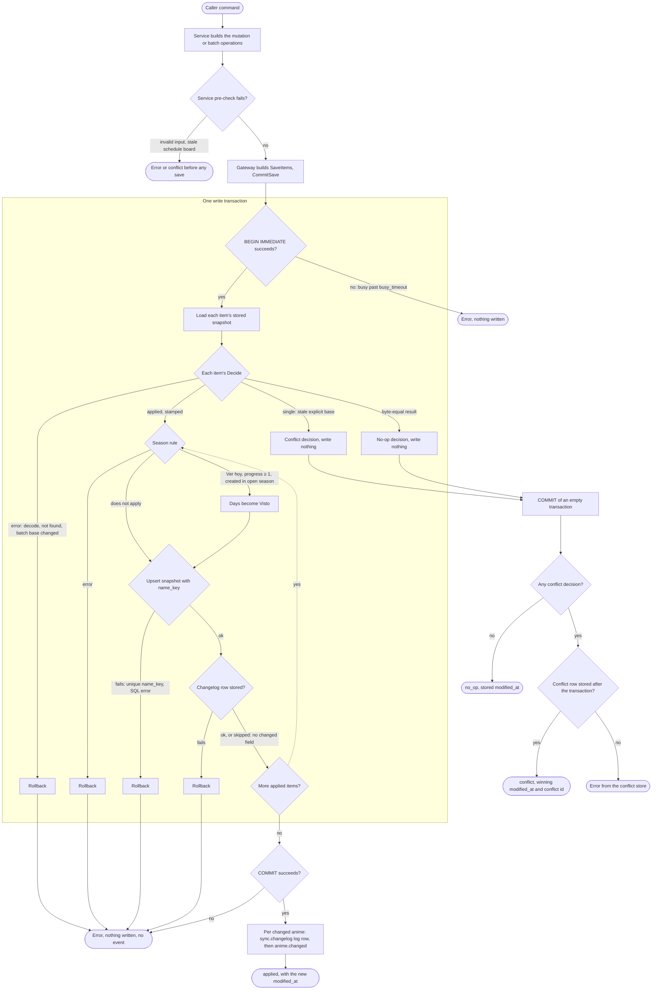

# Anime — workflow

One anime save, from a caller's command to every terminal outcome, as a single decision tree. Each
step names the function that takes it. Outcomes are the `AnimePatchOutcome` values the caller
receives (`applied`, `no_op`, `conflict`) or a returned error. The packages and ports the steps use
are in `overview.md`; the transaction helpers are in `../../cross-cutting/persistence.md`.

"Stored token" means the anime's `modified_at` as the save transaction reads it.

## The whole tree

Square boxes are steps, diamonds are decisions, rounded boxes are terminal outcomes. Sections 1–6
below expand each part.

## 1. The command — application services (`internal/anime`)

Every caller in the `overview.md` entry-point table reaches one of these service methods, which
turn the command into a `store.Gateway` call:

| Service method | Gateway call | Items |
|---|---|---|
| `WriteService.PatchAnime` (`write_service.go`) | `Update` with `CreateIfMissing` and the patch's `Base` | one |
| `WriteService.CreateCanonicalAnime` | `Create` | one |
| `EditorService.Save`, `Deactivate` (`editor_service.go`) | `UpdateRaw` with the Editor's base | one |
| `ScheduleService.Apply` (`schedule_service.go`) | `ApplyBatch`, or `UpdateRaw` for a stale entry | many, or one |
| `CreateService.CreateBatch` (`create_service.go`) | `ApplyBatch` over the creates and reflowed neighbours | many |

Service pre-checks run before any transaction, against a read outside it:

- validation failures return an error (for example `validateScheduleDraft`, `validateCreateRequest`,
  and `ensureNamesAreFree`, the readable half of name uniqueness);
- `ScheduleService.Apply` compares the board token first: a stale board returns `conflict`
  through `recordBoardConflict`; a stale entry is saved alone through `conflict`, an `UpdateRaw`
  with that entry's base, so it takes the single-save conflict path below.

## 2. The transaction — `AnimeSaveStore.CommitSave` (`internal/sync/anime_save_store.go`)

`Gateway.save` (`internal/anime/store/gateway_write_helpers.go`) hands one `SavePlan` to the save
store: the items, `Rule` (the Season rule), `NewEventID` and `Publish`. `CommitSave` runs:

1. `persistence.InWriteTx` takes the write lock up front (`BEGIN IMMEDIATE`). A database still
   busy after the 5000 ms busy timeout fails here with nothing written.
2. `decideSaveItems` loads every item's stored snapshot through the transaction's `Querier`
   (`loadStoredSnapshot`) and calls the item's `Decide`. Any `Decide` error aborts the save and
   rolls it back (section 3).
3. If any decision is a conflict, the body returns at once: nothing is written, the empty
   transaction commits, and the decisions go back to the gateway.
4. Otherwise `applyDecisions` takes each `applied` decision in item order: the Season rule
   (section 5), then `applyDecision`:
   - `deriveChangeType` reads, BEFORE the upsert, whether the anime already had a row: `create` or
     `update`;
   - `deriveChangedFields` compares the base and the desired snapshot's top-level fields;
   - the upsert writes `snapshot_json`, `snapshot_hash`, `modified_at` and `name_key`
     (`animeNameKey`, `internal/sync/anime_name_key.go`); a duplicate key fails on
     `idx_anime_snapshots_name_key`;
   - `recordPendingTx` (`internal/sync/changelog_store.go`) stores the changelog row under the
     event id `plan.NewEventID()` returned. An update or create that names no changed field stores
     no row.
   Any failure returns an error and rolls back every item of the save.
5. `COMMIT`. A commit failure is an error with nothing written.
6. Only after the commit, `plan.Publish` receives one `CommittedChange` per applied anime
   (section 6).

## 3. Decide — one item against its stored snapshot

Single saves (`Create`, `Update`, `UpdateRaw` in `internal/anime/store/gateway.go`) decode the
stored snapshot (`prepare`), apply the mutation, re-validate the result, and call `decide`
(`gateway_write_helpers.go`):

- Stored snapshot missing and `CreateIfMissing` false → `contracts.ErrAnimeNotFound`, rollback.
- Decode or mutation failure → error, rollback.
- Desired bytes equal the stored canonical bytes → `no_op`, stored token returned.
- An explicit `Base` that differs from the stored token → `conflict`.
- Anything else, including a write with no base → `applied`, stamped by `stampSingle`.
- `Create` refuses an anime that already holds a token with `ErrWriteBaseChanged`, rollback.

Batch saves (`ApplyBatch`, `decideBatchOperation`) never return a conflict decision. An operation
whose base token differs from the stored one returns `ErrWriteBaseChanged`, so **one stale item
rolls back the whole batch**: no item is stored, no changelog row, no event, and no conflict row.
The caller receives the error.

## 4. Stamping — the new `modified_at`

Every applied save stores a token strictly past the stored one:

| Save | Rule | Function |
|---|---|---|
| Single | `now`, raised to stored + 1 when `now` does not pass it | `stampSingle` (`gateway_write_helpers.go`) |
| Create | `stampSingle(0)`: `now` | `Create` (`gateway.go`) |
| Batch, operation index i | `now + i + 1`, raised to base + i + 1 when that does not pass the base | `ApplyBatch`, `decideBatchOperation` (`gateway.go`) |

`now` is read once per batch (`g.config.Now()`), but each operation is raised against its own
base independently. Tokens are strictly past each anime's base, not necessarily distinct or ordered
across the batch: with `now = 1000` and bases `[5000, 0]`, they are `[5001, 1002]`; bases
`[1001, 0]` produce `[1002, 1002]` (`decideBatchOperation`, `gateway.go`). The `applied` result
carries the last operation's token, not necessarily the batch's maximum.

## 5. The Season rule — `NewSectionMoveRule(season.WatchedSection)`

Wired in `newAnimeWriteDeps` (`internal/desktop/app_runtime_services.go`) as
`WriteServiceDeps.SaveRule`, so every write service's saves carry it. For each applied decision,
inside the transaction (`internal/anime/save_rule.go`):

1. Decode the desired snapshot; a decode failure rolls the save back.
2. `WatchedSection` (`internal/season/watched_rule.go`) returns `Visto` only when the first day is
   `Ver hoy`, progress is at least 1, and the anime is `AvailabilityCreated` in the season whose
   status is `open`. It reads `seasons` and `season_animes` through the same `Querier`; a query
   failure rolls the save back.
3. On `Visto`, the days become that one section with the last-watched instant preserved
   (`applyAnimePatch` with `PreserveLastWatched`), and the rewritten snapshot replaces the desired
   one.

The result is one snapshot write, one changelog row whose snapshot is already in `Visto` and lists
`days` among its changed fields, one event and one token. The returned decision carries the
rewrite, so a reconcile reports that final token.

## 6. After the transaction

- **Applied.** For each committed change, `logRecordedChangelog`
  (`internal/anime/store_gateway_config.go`) writes the `sync.changelog` row to `runtime_events`,
  then the service's `publishCommitted` hands it to `CommittedPublisher.PublishCommitted`
  (`internal/anime/committed_publisher.go`), which publishes `anime.changed` with the changelog
  row's event id.
- **No-op.** Nothing is written or published.
- **Conflict.** `saveOne` calls `recordConflict`, which stores the `conflicts` row through the
  conflict writer once the transaction is closed, so the two never share the connection. The
  result is `conflict` with the stored (winning) token and the conflict id
  `<animeId>-<nowMs>`. A failing conflict insert returns its error.
- **Error.** Nothing was written, nothing is published, and the caller receives the error.
