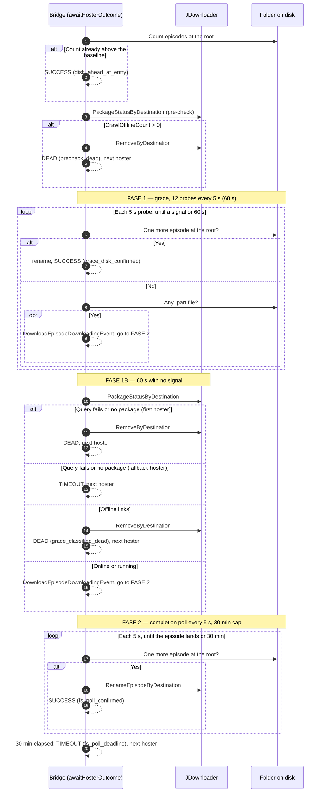

# Downloads — hoster attempt phases

This expands section 5 of `workflow.md`. The context's ports and invariants are in `overview.md`.

## Overview

`awaitHosterOutcome` monitors a single hoster attempt from enqueue to completion. The watcher has four phases, with explicit states and minimal JD API calls.

## States

| State | Trigger | Event | Next Action |
|-------|---------|-------|-------------|
| **pending** | AddAndStart succeeded, no evidence yet | `DownloadEpisodePendingEvent` (optional) | FASE 1: wait for .part or JD signal |
| **checking** | 5s passed, no new episode and no .part yet | (same state) | Retry every 5s until 60s |
| **downloading** | .part found OR JD confirmed alive | `DownloadEpisodeDownloadingEvent` | FASE 2: wait for video file |
| **completed** | Video file appears in folder | `DownloadEpisodeDownloadedEvent` | SUCCESS |
| **failed** | All hosters dead/timeout | `DownloadFailedEvent` | FAILED |

## Phases

```
awaitHosterOutcome(destination, baselineCount, firstHoster):

  ═══════════════════════════════════════════
  PRE-CHECK: JD already confirmed OFFLINE in crawl?
  ═══════════════════════════════════════════
  One JD API call BEFORE any wait.
  CrawlOfflineCount is a crawl-stage signal — it's determined
  before any download attempt. If JD already knows the links
  are dead, there's no point in the 60s grace period.

  status, err = PackageStatusByDestination(destination)

  if err == nil && CrawlOfflineCount > 0:
    → RemoveByDestination → DEAD (no wait)

  if err != nil:
    → JD unreachable, proceed to FASE 1 anyway

  ═══════════════════════════════════════════
  FASE 1 — 60s grace (filesystem only)
  ═══════════════════════════════════════════
  State: pending → checking → downloading
  No JD API calls. Only video and .part checks, in that order.
  12 probes at 5s intervals = 60s total (DetectStartProbeInterval, DetectStartGrace).

  for i = 0; i < 12; i++:
    sleep 5s
    video new at the root? → completed → SUCCESS (grace_disk_confirmed)
    .part found?
      → publish DownloadEpisodeDownloadingEvent
      → state = downloading
      → FASE 2

  ═══════════════════════════════════════════
  FASE 1B — JD re-evaluation (after 60s)
  ═══════════════════════════════════════════
  60s without filesystem evidence.
  One more JD API call to re-evaluate.
  Links may have changed state during the grace period.

  status, err = PackageStatusByDestination(destination)

  if err:
    firstHoster → RemoveByDestination → DEAD
    fallback    → TIMEOUT

  verdict = classifyJDStatus(status)

  DEAD (OfflineCount > 0):
    → RemoveByDestination → DEAD → fallback

  ALIVE (OnlineCount > 0 or Running):
    → publish DownloadEpisodeDownloadingEvent
    → state = downloading
    → FASE 2

  UNMATCHED (no packages):
    firstHoster → RemoveByDestination → DEAD
    fallback    → TIMEOUT

  ═══════════════════════════════════════════
  FASE 2 — downloading → completed
  ═══════════════════════════════════════════
  State: downloading → completed
  Filesystem only, every 5s. No JD API calls.
  30-minute safety timeout.
  Stop does not end this phase (nor FASE 1/1B): once JD accepted the enqueue it keeps
  downloading on its own, so the attempt runs to its end and the run honours Stop before
  the next hoster is enqueued and after the episode is renamed.

  while not timed_out (30 min safety cap):
    video new at the folder root?
      → completed → SUCCESS
    sleep 5s

  → TIMEOUT
```

## Sequence Diagram



Stop has no effect inside this diagram: the attempt runs on `context.WithoutCancel` (see
`workflow.md`, "Where Stop takes effect").

## Legend

| Symbol | Meaning |
|--------|---------|
| SUCCESS | Episode downloaded → `DownloadEpisodeDownloadedEvent` |
| DEAD | Hoster dead → fallback to next |
| TIMEOUT | Could not confirm → stop without fallback |
| `pending` | Waiting for download evidence (FASE 1) |
| `downloading` | .part seen or JD confirmed alive → `DownloadEpisodeDownloadingEvent` |

## Design Decisions

1. **JD API called twice per hoster (not per tick)**: PRE-CHECK and FASE 1B. FASE 2 has NO JD API calls — pure filesystem.

2. **`CrawlOfflineCount > 0` signals immediate DEAD**: This is a crawl-stage signal from `LinkGrabber.Packages()`. If JD determined links are OFFLINE during crawl, there's no point in the 60s grace period.

3. **60s grace covers the "online but dead" case**: Mediafire links were ONLINE in crawl (JD recognized the URL format) but the hoster failed at download time. The 60s .part check catches this without false positives.

4. **First vs fallback hoster distinction**: First hoster is aggressive (DEAD after failed checks). Fallback hosters are conservative (TIMEOUT instead of DEAD for uncertain cases, so JD has time to process links).

5. **No 30-minute timeout for alive hosters**: If JD confirms links are ONLINE/Running, the hoster stays in FASE 2 until the file appears. The 30-minute safety cap only protects against truly stuck downloads.
