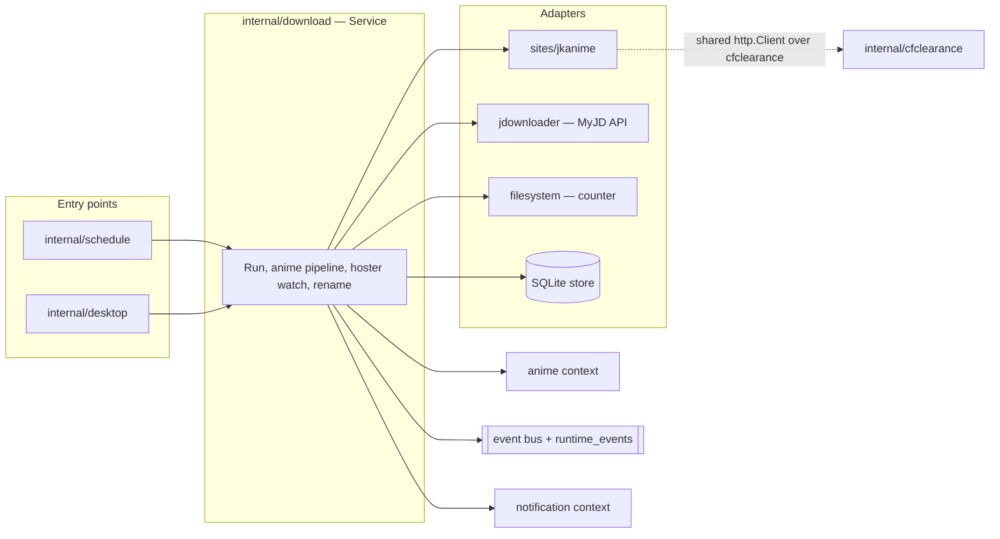

# Downloads — overview

The downloads context finds the episodes an anime is missing on disk, fetches their links from a
provider site, and hands them to JDownloader (JD) through MyJDownloader. It decides success only
from the anime's folder on disk, never from JD's own verdict.

For the step-by-step run, read `workflow.md`. For how one hoster attempt is watched, read
`hoster-attempt-phases.md`.

## Responsibility

- Owns: which episodes to fetch, the hoster fallback order, watching each attempt to a terminal
  outcome, renaming the downloaded episode, and the run ledger (runs, progress, schedule, JD
  configuration).
- Does not own: anime state (the `anime` context, read through `contracts.AnimeQueryService`),
  Cloudflare clearance (`internal/cfclearance`, ADR-030), or notifications (`internal/notification`).

## Package map

| Package | Role |
|---|---|
| `internal/download` | The `Service` (application core): run orchestration, per-anime pipeline, hoster watch, rename, notifications, run ledger |
| `internal/download/sites`, `sites/jkanime` | Provider adapters: list episodes, resolve an episode page, extract hoster links |
| `internal/download/jdownloader` | JD adapter behind the `JDClient` port, built on `github.com/Disble/jdownloader-go` |
| `internal/download/filesystem` | Disk adapters: the episode counter and the episode name helper |
| `internal/download/config` | Timing constants: grace probe interval and length, completion poll interval and cap |
| `internal/download/crypto` | Encryption of the stored MyJDownloader password |
| `internal/download/dbschema` | SQLite schema of the context's tables |

Main files of the core, all in `internal/download/`:

| File | Holds |
|---|---|
| `service.go` | `ServiceDeps` (every port), `RunOnce`, the concurrency cap |
| `service_scoped_runs.go` | `RunAnime`, `RunAnimes` (single-anime and selection runs) |
| `service_pipeline.go` | Per-anime preparation, the episode loop, hoster ordering and fallback |
| `service_hoster_watch.go`, `service_hoster_watch_exit.go` | One hoster attempt from enqueue to outcome, and its exit reasons |
| `service_rename.go` | Completing a downloaded episode: rename through JD, duration notice |
| `decision.go`, `destination.go` | Whether an anime can be downloaded and into which folder |
| `jd_gate.go` | Bringing JD online once per run, launching it when needed |
| `store.go`, `sqlite_store*.go` | The `Store` port and its SQLite adapter |

## Ports and adapters

Every port is a field of `ServiceDeps` (`service.go`) and is wired once in the composition root,
`internal/desktop/app_startup_runtime.go`.

| Port | Adapter | Used for |
|---|---|---|
| `Animes contracts.AnimeQueryService` | anime context | Which animes are active and their folder, site URL and episode total |
| `Sites SiteRegistry` | `sites/jkanime` | Episode listing, episode page, hoster links |
| `LibraryRoot` | `App.libraryRoot` (desktop) | The library root an anime without its own folder is placed under |
| `JD jdownloader.JDClient` | `jdownloader` (MyJD API) | Enqueue, package status, package removal, episode rename |
| `Counter filesystem.EpisodeCounter` | `filesystem` | Episodes present at the folder root |
| `HasPartFiles` | `hasPartFilesRecursive` (`service_hoster_watch.go`) by default | Whether a `.part` file shows that JD started writing |
| `Store` | `sqlite_store*.go` | Hoster priority, JD config, schedule, run ledger |
| `Notifier`, `EpisodeDurationNotice` | notification context, duration probe | Run results and episode duration warnings |
| `Bus`, `Logger` | in-memory event bus, eventlog | Domain events and the Activity record |

`JDClient` (`internal/download/jdownloader/client.go`) exposes `Connect`, `ListDevices`,
`EnsureOnline`, `AddAndStart`, `PackageStatusByDestination`, `RemoveByDestination`,
`RenameEpisodeByDestination` and `Disconnect`. `RemoveByDestination` removes the package from both
JD lists (LinkGrabber and downloads) and never deletes files.

## Entry points

| Caller | Method | Trigger |
|---|---|---|
| `internal/schedule` scheduler, through `internal/desktop/app_download_scheduler.go` | `RunOnce` | The daily schedule (`scheduled`) and the manual full check (`manual`) |
| `internal/desktop/app_download.go` | `RunAnime` | Downloading one anime from its screen |
| `internal/desktop/app_notification_center.go` | `RunAnime` | A notification action |
| `internal/desktop/app_season_availability.go` | `RunAnimes` | A season-mode selection |

Stop goes through `App.CancelDownloadRun` (`internal/desktop/app_download_cancel.go`), which cancels
the run's context. Where the run honours that cancellation is described in `workflow.md`.

## Events

The core publishes `DownloadEpisodeAvailableEvent`, `DownloadEpisodeDownloadingEvent`,
`DownloadEpisodeDownloadedEvent`, `DownloadFailedEvent` and `DownloadSkippedEvent` on the bus, plus
the run lifecycle `download.run_started`, `download.run_progress` and `download.run_finished`. Each
step is also written to `runtime_events` through the logger, with `exit`, `hoster`, `attemptIndex`,
`baseline` and `observed` on episode-level entries.

## Invariants

- **Bridge never moves or deletes files.** The only change on disk is JD renaming the episode it just
  downloaded. `RemoveByDestination` only removes JD list entries.
- **The disk is the only success authority.** An episode counts as downloaded when the episode count
  at the folder root rises above the count taken before the attempt. Subfolders and `.part` files
  never count.
- **The episode cursor comes from the disk**, as max(highest episode number, file count) at the root
  (`downloadedEpisodeBaseline` in `service_pipeline.go`). An episode that does not land ends the
  anime, because the cursor cannot express a gap.
- **Every wait has a cap**: JD launch, the 60 s grace, the 30-minute completion poll.
- **Stop never interrupts an attempt JD has accepted.** The attempt runs on
  `context.WithoutCancel`, and the run stops before the next hoster is enqueued or after the
  episode is renamed.
- **JD gets no more transfers than it runs at once.** `MaxConcurrentAnimes` caps how many animes are
  processed in parallel. A queued transfer would write no `.part` and look like a dead hoster.

## Known drift

- `filesystem.Renamer` is wired in `internal/desktop/app_startup_runtime.go` but the core never calls
  it; the rename goes through `JDClient.RenameEpisodeByDestination`. It is dead code that can rename
  files on disk, and is pending removal.
- The `.part` sensor (`HasPartFiles`) still searches subfolders, so a stale `.part` in a user
  subfolder can be read as a download that started.
