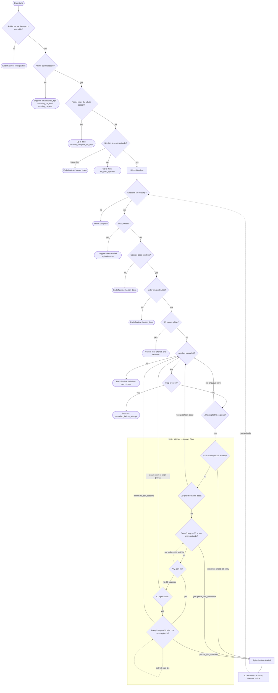

# Downloads — workflow

One download run, from trigger to every terminal outcome, as a single decision tree. Each step names
the function that takes it. Persisted values (`exit`, `reason`, `failureKind`) are quoted literally.
The packages and ports the steps use are in `overview.md`.

"Folder" means the anime's folder without its subfolders; "count" means the episode count at that
folder root.

## The whole tree

Square boxes are steps, diamonds are decisions, rounded boxes are terminal outcomes. Dashed edges
loop back. Sections 1–6 below expand each part.

## 1. The run

`RunOnce`, `RunAnime` or `RunAnimes` (`service.go`, `service_scoped_runs.go`) opens a run row,
selects the animes, and processes up to `MaxConcurrentAnimes` of them in parallel. Each anime follows
section 2. The run finalizes its row as finished, or as canceled after Stop.

## 2. One anime — `processAnime`, `prepareAnimeDownload` (`service_pipeline.go`)

1. **Can the anime be downloaded?** (`EvaluateAnimeForDownload`, `decision.go`)
   - No folder and the library root cannot be read → end of anime, `failureKind=configuration`.
   - Not downloadable → skipped, `download.skipped` with `reason` `unsupported_tipo`,
     `missing_pagina` or `missing_carpeta`.
2. **Does the folder already hold the whole season?** count = episode total →
   up to date, `reason=season_complete_on_disk`.
3. **Does the site list a newer episode?** (`ListEpisodes`, `NeedsDownload`)
   - The listing fails → end of anime, `failureKind=hoster_down`.
   - Latest online ≤ count → up to date, `reason=no_new_episode`.
4. **Bring JD online** for the run (`jdGate`, `jd_gate.go`), launching it when needed. Then enter the
   episode loop.

## 3. The episode loop — `downloadAvailableEpisodes`, `processAvailableEpisode`

Repeats while count < latest online:

1. **Did the user press Stop?** → stop; what is already downloaded stays. This is the Stop point
   after every rename.
2. **Resolve the page of episode count + 1** → fails: end of anime, `failureKind=hoster_down`.
3. **Extract the hoster links** → fails or none: end of anime, `failureKind=hoster_down`.
4. **Is JD known to be offline?** → offer the links for a manual download
   (`download.manual_link_offered`) and end the anime.
5. **Order the hosters** by the stored priority (`orderHosters`) and try them in turn (section 4).
   - No hoster succeeded → end of anime, `download.failed` with the last `failureKind`.
   - One succeeded → `download.episode_downloaded`, re-read the count from the disk, next iteration.

Every episode that does not land ends the anime. There is no skip to the next episode, because the
cursor is read from the disk and cannot express a gap.

## 4. The hoster loop — `enqueueWithFallback`

For each hoster in order:

1. **Did the user press Stop?** → end of anime, `exit=cancelled_before_attempt`. This is the Stop
   point before any enqueue: nothing reaches JD after Stop.
2. **Does JD accept the enqueue?** (`AddAndStart`) → no: `exit=enqueue_error`, next hoster.
3. **Watch the attempt** (section 5). Success → episode downloaded. Any other outcome → next hoster.

## 5. One hoster attempt — `awaitHosterOutcome` (`service_hoster_watch.go`)

From here on the attempt ignores Stop (`context.WithoutCancel`): JD keeps downloading on its own, so
the attempt always runs to one of the outcomes below. `hoster-attempt-phases.md` has the timing
detail.

1. **Is the count already above the baseline?** → success, `exit=disk_ahead_at_entry`.
2. **Pre-check: does JD report the link dead?** → remove the package from JD, next hoster,
   `exit=precheck_dead`.
3. **Grace: every 5 s, for up to 60 s, two questions in order:**
   1. Is there one more episode in the folder? → success, `exit=grace_disk_confirmed`.
   2. Is there a `.part` file? → go to step 5.
   3. Neither, and 60 s have not passed → wait 5 s and ask again.
4. **After 60 s with neither: ask JD once more.**
   - No JD client → `exit=grace_client_absent_*`, next hoster.
   - The query fails → `exit=grace_query_error_*`, next hoster.
   - Dead → `exit=grace_classified_dead`, next hoster.
   - No sign either way → `exit=grace_no_signal_*`, next hoster.
   - Alive → step 5.
5. **Completion poll: every 5 s, for up to 30 min.**
   - One more episode in the folder → success, `exit=fs_poll_confirmed`.
   - 30 min elapsed → `exit=fs_poll_deadline`, next hoster.

The `_first` / `_fallback` suffix records whether the hoster was the first one (marked dead) or a
fallback (marked timed out); both move on to the next hoster. A JD package is removed only on a
dead or silent hoster, never after a success.

## 6. Completing a downloaded episode — `completeDownloadedEpisode` (`service_rename.go`)

1. **Rename through JD** (`RenameEpisodeByDestination`) to `<anime name> - <NN>.<ext>`, so the cursor
   can read the episode number back. A rename failure is logged (`download.rename_failed`) and the
   episode still counts as downloaded.
2. **Episode duration notice**: warn when the file's duration does not look like a full episode.
3. Back to the episode loop (section 3, step 1).

## Where Stop takes effect

| Point | Effect |
|---|---|
| Before each episode (section 3, step 1) | The anime stops; downloaded episodes stay |
| Before each hoster enqueue (section 4, step 1) | `cancelled_before_attempt`; nothing new reaches JD |
| During an attempt (section 5) | No effect: the attempt runs to its outcome, and the run stops at the next point above |

A Stop during a long download therefore takes effect when that episode lands and is renamed, or at
the 30-minute cap. Interrupting a transfer JD has already accepted is not supported yet.
