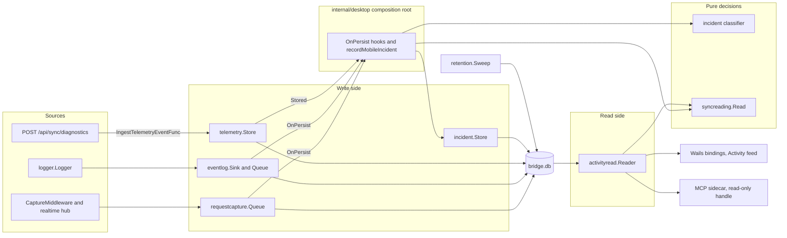

# Observability — overview

The observability context records what Bridge and its devices did, keeps each kind of evidence for as
long as it is worth keeping, and answers the Activity screen and the debugging AI from that record. It
reads and writes its own tables only: it changes no anime, device or download state, and it publishes
nothing on the event bus.

For a mobile report from arrival to display as a decision tree, read `workflow.md`. For why the layers
exist, what they cost and how the feed looks, read `docs/observability/` (start at its `README.md`), which
stays the reference for the design. ADR-028 records the retention decision and ADR-026 the report store.

Everything on this page was read from the code on 2026-11-06.

## Responsibility

- Owns: captured requests, runtime events, incidents, the hourly rollup, response versions, stored mobile
  reports, their retention, and the read models over all of them.
- Decides: what opens an incident (`incident`), what a failed sync means (`syncreading`), and how long a row
  lives (`retention`).
- Does not own: domain history (`activity_log` belongs to `internal/activity`, and Activity only reads it),
  device state (`last_seen_at_ms` belongs to `internal/sync`), the shared logger port (`internal/logger`), or
  the feed's presentation (`frontend/src/features/activity`).

## Package map

| Package | Role |
|---|---|
| `internal/observability/requestcapture` | Non-blocking queue and sanitized persistence of captured requests; the ledger upserts (rollup, response versions); the read-only database handle and capture reader |
| `internal/observability/eventlog` | The sink behind the shared logger: bounded queue, redacted and size-bounded metadata, `runtime_events` |
| `internal/observability/telemetry` | The kind-discriminated store of mobile reports, its registry (`cycle_report`, `episode_action`, `screen_stall`, `hourly_summary`, `runtime_transition`), `ReadReportFacts`, `ReadHourlySummary` and the report reader |
| `internal/observability/syncdiag` | The `cycle_report` wire contract and its closed vocabularies; `telemetry` registers its validator |
| `internal/observability/syncreading` | The reading of a failed sync. Pure: no database, no state, no clock |
| `internal/observability/incident` | The pure classifier (`ClassifyRequest`, `ClassifyEvent`, `ClassifyMobileReport`, `ManualPin`) and the `incidents` store |
| `internal/observability/retention` | `Sweep` and `RunLoop`: the 2-hour recorder, the 90-day ledger, the incident trim and the response-body strip |
| `internal/observability/activityread` | The read models: `Feed`, `Overview`, `Now`, `Incidents`, `IncidentDetail`, `History`, `Recorder`, `Runs`, `RunStory`, `SyncStarts`, `PhoneReport` and others. It only reads |
| `internal/observability/obserr` | The structured error envelope shared by the read tools |

Adapters and wiring outside the context:

| File | Holds |
|---|---|
| `internal/api/capture_middleware.go`, `internal/realtime/hub_capture.go` | Capture of HTTP requests and of WebSocket lifecycle and broadcasts |
| `internal/api/handlers/sync_diagnostics_handler.go` | `POST /api/sync/diagnostics` and the closed refusal vocabulary |
| `internal/api/server.go` | The start record: the `api.listening` row and `listeningMetadata` |
| `internal/desktop/app.go` | `App.shutdown` writes the clean close, `app.closed` |
| `internal/desktop/app_incidents.go` | The persist hooks, `recordMobileIncident` and the `waitedForBridge` gate |
| `internal/desktop/app_sync_diagnostics.go` | `ingestSyncDiagnostics`: store, event, incident |
| `internal/desktop/app_runtime_services.go` | `captureLastContacts`, the orphan capture sweep and `startRetentionSweepLoop` |
| `internal/desktop/app_activity_feed.go`, `app_activity_read.go`, `app_activity_live.go`, `app_activity_pin.go` | The Wails bindings of Activity, the `activity.recorder` event and "pin this moment" |
| `internal/mcp/requestcapture`, `cmd/autoreas-request-mcp` | The MCP sidecar: 11 read-only tools over `activityread` on a read-only handle |

## Ports and adapters

The capture and event writers sit behind bounded queues, so a slow database never blocks a request. Each
queue has one drain goroutine and an `OnPersist` hook; the composition root uses it to stream the Live row
and to record incidents. The classifier and the reading are pure, so the composition root hands them
everything they need.

| Port | Declared in | Adapter |
|---|---|---|
| `requestcapture.Upserter` | `requestcapture/queue.go` | `requestcapture.SQLiteStore` |
| `eventlog.Inserter` | `eventlog/queue.go` | `eventlog.SQLiteStore` |
| `telemetry.Kind` | `telemetry/kind.go` | `CycleReportKind`, `EpisodeActionKind`, `ScreenStallKind`, `HourlySummaryKind`, `RuntimeTransitionKind` |
| `handlers.IngestTelemetryEventFunc` | `internal/api/handlers/common.go` | `App.ingestSyncDiagnostics` |
| `logger.Logger` | `internal/logger` | The fanout logger, which feeds `eventlog.Sink` |

`internal/desktop/app_incidents.go` calls `activityread.Reader.SyncStarts` on the report's write path. It is
the one place a read model serves a write decision, so the read and the incident gate share one definition
of a start.

## Events

The context publishes nothing on the bus. A bus `Publish` does not reach Activity either: only a logger row
lands in `runtime_events` (`.claude/skills/activity-events/SKILL.md`). The rows this context relies on or
writes itself:

| Event type | Level | Written by | Meaning |
|---|---|---|---|
| `api.listening` | info | `internal/api/server.go` | One Bridge start. Metadata `addr`, and `lastContacts` when a device is active |
| `tracer.step` "tracer bullet ready" | info | `internal/tracerbullet/runner.go` | The startup marker MCP reads (`retention.StartupMarker`); Activity reads it as the boot of a run |
| `app.closed` | info | `internal/desktop/app.go` (`App.shutdown`) | One clean close, logged before the event queue stops so it is flushed. No metadata. A crash writes none |
| `sync.diagnostics_stored` | info | `internal/desktop/app_sync_diagnostics.go` | One report stored; Activity hides it because it restates the row |
| `api.last_contacts_unread` | warn | `internal/desktop/app_runtime_services.go` | The last contacts could not be read at start; readings go by start times alone |
| `incident.sync_reading_failed` | warn | `internal/desktop/app_incidents.go` | The starts or the device's first report could not be read for a failed sync report; it opens its incident |
| `incident.record_failed` | error | `internal/desktop/app_incidents.go` | An incident could not be stored. The event hook skips this type, so it cannot loop |
| `api.capture_swept` | warn | `internal/desktop/app_runtime_services.go` | Pending captures left by a previous process were swept |

`activity.recorder` is a Wails event, not a row: it streams each persisted capture and event to the screen.

## Storage

| Table | Declared in | Kept |
|---|---|---|
| `request_captures` | `internal/sync/schema.go` | 2 hours, unless pinned by an incident, journal class (a write verb, or a reconcile that touched an anime) or WebSocket. Everything leaves at 90 days |
| `request_capture_metadata` | `internal/sync/schema.go` | Key and value rows of the capture schema; outside the sweep |
| `request_rollup_hourly` | `internal/sync/schema.go` | 90 days |
| `response_versions` | `internal/sync/schema.go` | 90 days after last seen |
| `runtime_events` | `eventlog/schema.go` | Noise (`NoiseEvent`) 2 hours unless pinned; the rest 90 days |
| `incidents` | `incident/schema.go` | 90 days, then the first 3 and latest 3 per fingerprint |
| `device_telemetry_events` | `telemetry/schema.go` | Outside the sweep. Row caps per kind, shared by all devices: `cycle_report` 5,000, `screen_stall` 5,000, `episode_action` 20,000, `hourly_summary` 2,160, `runtime_transition` 2,340 |
| `device_sync_diagnostics` | Retired (ADR-026) | Never created on a fresh install; on an existing one its rows stay, unread |

A reading has no storage: it is computed on each read. The start record is metadata on an existing row.

## Invariants

- **A report is data, a reading is interpretation.** A reading is never stored and never changes a report.
  Reports are stored once, as `payload_json`, re-serialized from validated values.
- **The classifier and the reading are pure.** `incident/trigger.go` and `syncreading/reading.go` touch no
  database, take no clock and hold no state.
- **One start definition for readings.** `syncStartSQL` in `activityread/sync_readings.go` serves both the
  incident gate and the feed. `syncreading.Read` is the only rule, and `Reader.FirstReports` its only answer
  for F, the device's first report after the start.
- **The grace period is mobile's retry.** A failure has three periods: Bridge off (T to N), grace period (N to
  N + `syncreading.GracePeriod`, 20 minutes, mobile's longest normal retry) and overdue. Where F falls decides
  the reading. `GracePeriod` changes only with mobile's retry interval.
- **The last contact is read before anyone can contact.** `captureLastContacts` runs before `startHTTPServer`,
  because the first contact overwrites the value.
- **Losing an incident is the worse error.** Any failure to read the starts or F lets the report open its
  incident. A failed reading never hides a failure.
- **An incident write never fails the write that fired it.** `recordIncident` logs and returns, under a 250 ms
  budget, because it runs on a drain goroutine or on the report's POST path.
- **A retry is free.** `UNIQUE(kind, event_id)` makes a duplicate a 204 with no row, event or incident.
- **Lines and counts agree.** `readFailedSyncs` is the one read behind feed lines and bucket counts.
- **The read side stays bounded.** Every `activityread` query has a time predicate on an indexed column, a key
  or a limit. Sync readings cap at 2,000 starts and 5,000 failed actions, and ask F with one indexed seek on
  `(device_id, reported_at_ms)` per device and start. A traffic hour's `hourly_summary` rows are matched by
  their unindexed `observed_at_ms` within the kind index, bounded by the kind's 2,160-row cap.
- **Only `api.listening` or the older listening row is a reading's start.** Metadata that cannot be decoded
  leaves the start valid with no last contacts.
- **A run ends at its close or at its last row.** `bridgeRuns` (`bridge_runs.go`) pairs each start with the
  close stored after the previous start. Without one, the run before ends at the last row stored before the
  start's boot marker, never at the starting run's own boot rows. Starts, closes and markers are read once per
  read; the last rows take one query of one indexed seek per unclosed run.
- **A tablet silence counts only time Bridge was on.** `tabletSilences` (`tablet_silence.go`) cuts each gap of
  60 minutes or more between a device's heard times by the runs, so it never spans Bridge off or an unknown
  Bridge state. It is computed on every read that includes Traffic outside the phone origin, from one window
  query over `device_telemetry_events` (bounded by the per-kind caps) plus the runs; nothing is stored, and
  lines and counts share it. Before a device's oldest retained `cycle_report` it is heard only by the hour of
  an `hourly_summary` with a `closed` attempt.

## Entry points

| Caller | Method | Trigger |
|---|---|---|
| `internal/api/router.go` | `syncDiagnostics.ServeHTTP` | A mobile report |
| `CaptureMiddleware`, `internal/realtime/hub.go` | `requestcapture.Queue.TryEnqueue` | Every HTTP request, WebSocket connect, disconnect and broadcast |
| `logger.Logger.Logf` | `eventlog.Sink.WriteEntry` | Every logged fact above the debug filter |
| `App.startRetentionSweepLoop` | `retention.Sweep`, `RunLoop` | Once after bootstrap, then every 5 minutes |
| `SearchActivityFeed`, `GetActivityOverview` | `Reader.Feed`, `Reader.Overview` | The Activity screen |
| `GetActivityEvent`, `GetActivityIncident`, `GetActivityRequest`, `GetActivityRunStory`, `GetActivityChangeContext`, `GetActivityPhoneReport` | The matching `Reader` method | Opening a feed line |
| `PinActivityMoment` | `incident.Store.Record` | "Pin this moment" |
| `cmd/autoreas-request-mcp` | `internal/mcp/requestcapture` tools | `get_status`, `list_incidents`, `get_incident`, `get_request`, `search_history`, `list_runs`, `get_run_story`, `list_recorder`, `list_response_versions`, `get_hourly_totals`, `count_events`. The coverage of `get_incident` and `search_history` gives each report kind's range (`coverage.go`) |

## Known drift

- **Two definitions of a start.** MCP `get_status` reads the tracer row (`bridgeStartedAt`,
  `internal/mcp/requestcapture/tools.go`). The feed's System line reads `api.listening`, and readings read
  `api.listening` or the older listening row. The rows are written at different moments of one startup.
  `bridgeRuns` reads both: the listening row is the start, the tracer row the boot that bounds the run before.
- **A reading can age.** It depends on the retained starts. A report row can outlive its start, because reports
  sit on row caps and starts on the 90-day ledger. Such a report then has no reading and shows as a plain
  failure, although it opened no incident.
- **An incident and a reading can disagree.** Incidents opened before this reading existed, opened because
  the starts or F could not be read, stay listed while the feed reads those reports as Bridge was off. Reports
  ingested under the earlier 30-minute window, measured from the latest start, kept the gate's answer of that
  time: a report that read Bridge was off then and reads late now has no incident. The neutral
  line links to none of them (`attachIncidents`).
- **Failed Traffic lines are off by default.** Traffic starts off and the failure switch only narrows the
  selected types (`toFeedQuery`, `frontend/src/features/activity/feed/activity-feed-filters.helpers.ts`). So
  "Sync failed" and "Tablet came back late" stay hidden until Traffic is on; the Traffic chip counts them.
- **ADR-026 and JSON filters.** ADR-026 says a payload field becomes a projection when a read surface filters on
  it. `feedFailedReportSQL` and `readFailedSyncs` filter on `json_extract(payload_json, ...)` with no projection.
  `readFailedSyncs` narrows by the indexed `kind` and `reported_at_ms` first, and the 2026-11-07 copy held 101 matching
  rows. No decision records this yet.
- **Schema away from its owner.** The request tables are declared in `internal/sync/schema.go`, not in
  `requestcapture`.
- **Repeated constants.** `activityread` repeats `RecorderSpan`, `LedgerSpan` and the startup marker literal that
  `retention` declares.
- **The battery does not see mobile incidents.** The POC simulator triggers only on `device_sync_diagnostics`,
  so it cannot measure what a missing incident costs (`docs/observability/mobile-reports.md`).
