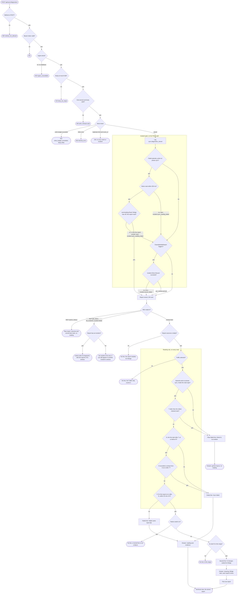

# Observability — workflow

One mobile report, from `POST /api/sync/diagnostics` to every place it can be shown, as a single decision
tree. Each step names the function that takes it. The packages and ports are in `overview.md`; the meaning of
the readings and their measured figures are in `docs/observability/mobile-reports.md`.

T is when the device failed (`observed_at_ms`), R is when Bridge received the report (`reported_at_ms`), and D
is the device.

## The whole tree

Square boxes are steps, diamonds are decisions, rounded boxes are terminal outcomes. Every report that ends in
"Report stored" is answered 204, after the incident step. Sections 1–6 below expand each part.

## 1. Arrival — `NewSyncDiagnosticsHandler` (`internal/api/handlers/sync_diagnostics_handler.go`)

The device comes from the bearer token and R from Bridge's clock, never from the body. The body is bounded to
`telemetry.MaxBodyBytes` before its kind is resolved, then the kind's own strict decode validates it. An absent
kind means `cycle_report`.

Every refusal except the 401 carries a `code` from the closed `RefusalCode` vocabulary. `CaptureMiddleware`
records the request whatever the outcome, so a refusal is also a captured failure and can open its own request
incident (`recordRequestIncident`).

## 2. Store — `telemetry.Store.Insert` (`internal/observability/telemetry/store.go`)

| Outcome | Row | Event | Incident step | Answer |
|---|---|---|---|---|
| `Stored` | Inserted. The kind's row cap is pruned on the first write of a process, then every 100 writes | `sync.diagnostics_stored` | Runs | 204 |
| `Duplicate` | None | None | Skipped | 204 |
| `Shed`, write budget | None | None | Skipped | 503 with `Retry-After` |
| `Shed`, other error | None | None | Skipped | 500 |

## 3. Incident gate — `App.recordMobileIncident` (`internal/desktop/app_incidents.go`)

1. `telemetry.ReadReportFacts` reads outcome, phase, cause and stall duration from the stored payload.
2. `waitedForBridge` applies only when `syncreading.Applies` holds: `episode_action`, outcome `failed`, phase
   `sync`. It reads the starts under the 250 ms incident budget and adds the running process with
   `WithCurrentStart`, because that process's own `api.listening` row may not be flushed yet. When the rule
   needs F, `Reader.FirstReports` makes one indexed seek on `(device_id, reported_at_ms)` under the same
   budget. The report being ingested is one of D's reports, so it counts as F even before its row is visible.
3. Bridge was off ends here: no incident, no pinned window. The report row and its capture stay.
4. Every other case reaches `ClassifyMobileReport`, which is unchanged. A failed read of the starts or of F
   answers "not Bridge off" and logs `incident.sync_reading_failed`.
5. `recordIncident` stores the occurrence, and retention pins the window from 2 minutes before to 30 seconds
   after. A failed write logs `incident.record_failed` and never reaches the report's answer.

## 4. Reading rule — `syncreading.Read` (`internal/observability/syncreading/reading.go`)

`Read` takes the failure, every retained start, oldest first, and a `FirstReport` lookup, and fills `Evidence`
as it goes. It asks the lookup once, and only when the last row of the table below decides.

| Evidence | Meaning |
|---|---|
| `NextStartMS` | N, the first start after T, the one that decides whether Bridge came up before the report |
| `LastContactMS` | D's last contact in N's record, when it holds one |
| `FirstReportMS` | F, D's first report of any kind received at or after N, never later than R; nil when it did not decide |

| Test, in order | Reading |
|---|---|
| No starts, or T older than the oldest | `NoReading` |
| No next start | `RealFailure` |
| `LastContactMS` at or after T | `RealFailure` |
| N came after R | `RealFailure` |
| F minus N at most `RetryWindow` (20 minutes, mobile's longest normal retry) | `BridgeOff` |
| Otherwise | `TabletLate` |

F and not R decides, because mobile sends 3 reports per cycle: the later reports of a backlog arrive later on a
healthy tablet. A reading is computed again on each read, so the same rule serves the gate and the feed. The
gate's list of starts also holds the running process; the feed reads the stored row instead. Both answer F
with `Reader.FirstReports`, which keeps each device and start's answer for one read.

## 5. Feed line — `Reader.feedPhoneReportLines` (`internal/observability/activityread/feed_sources.go`)

`readFailedSyncs` (`sync_readings.go`) is the one read behind lines and counts. It reads the starts, then the
failed episode actions from the range start on, newest first, up to 5,000, closes those rows, and only then reads
each one: the database holds one connection, so the F lookups cannot run while the rows are open.

- It reads to the newest report, past the end of the range, because a group's reports arrive after its start N
  with no fixed bound. A group is whole whatever the range.
- `failedReportSQL` removes every report that reads Bridge was off from the plain failed lines.
- `groupLines` adds one line of kind `LineBridgeOff` per start N in range. It sits at N and is keyed by it,
  so neither its position nor its id moves as more reports arrive.
- `countGroups` counts each group as one Traffic line with no failure, in the bucket of its start.
- With the failure switch on, `feedPhoneReportLines` returns before adding groups.
- A report whose start lies before the range shows no line in that range: it left the failed lines, and its group
  is listed where its start is.
- `attachIncidents` links a phone report to its incident by event id. A `LineBridgeOff` line gets no link.

## 6. Drawer and Technical view

`SyncReading` and `BridgeOff` travel on the `FeedLine`, so the drawer needs no extra read for the reading. The
Technical view reads the report with `GetActivityPhoneReport` (`Reader.PhoneReport`). Its `payload_json` is the
validated record Bridge stored, so the screen calls it the stored report. A group holds several reports, so the
Data tab offers a picker.

The frontend side lives in `frontend/src/features/activity/drawer/drawer-reading.helpers.ts`,
`use-drawer-stored-report.ts` and `ui/ActivityTechnicalView/`.
