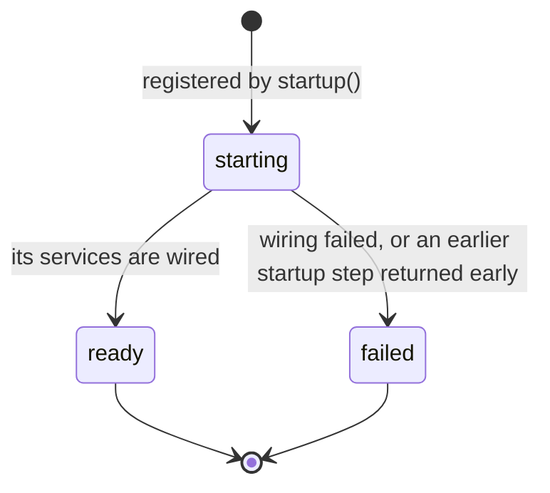
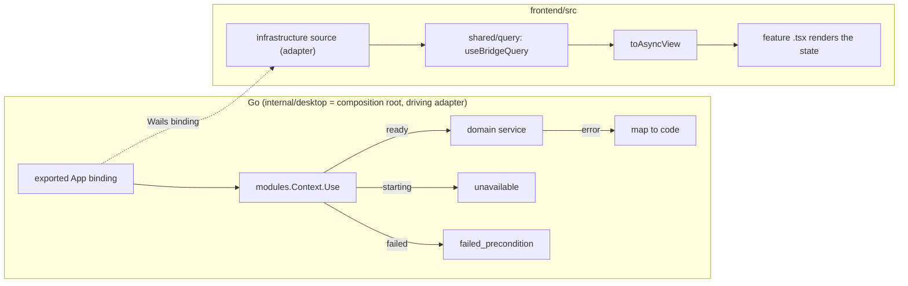
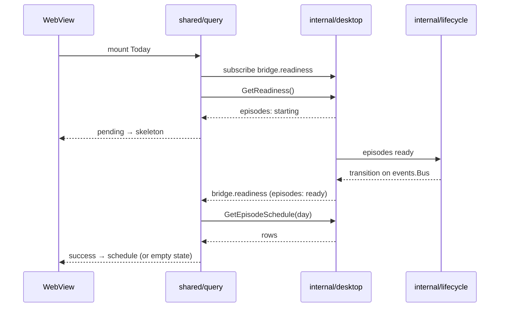

# Async state — readiness, failures and server state

How a value travels from a Go module to a screen, and how "not ready", "failed" and "empty" stay
distinct on the way. The decision and its alternatives are in `docs/adr/032-async-state-standard.md`;
what each state looks like is in `docs/design/patterns/loading-empty-error.md`.

This page covers both sides of the Wails bridge: the Go composition root (`internal/desktop`) and the
frontend layers under `frontend/src`.

## Status

The contract below is being introduced by ADR-032, module by module. Until a module migrates it keeps
its legacy shape; "Known drift" lists what the code does today. When this page and the code disagree,
the code is the runtime truth.

## Module lifecycle

Each module (a bounded context as the desktop shell sees it) has one readiness state in the registry
`internal/lifecycle`. Only the composition root writes it; domains never import it.

- Every transition is published on `events.Bus` and forwarded to the frontend as `bridge.readiness`.
- `GetReadiness()` answers the whole snapshot, so a frontend that subscribed late still learns the state
  (Wails drops events emitted before a listener exists).
- No module stays `starting` forever: an early return in `startup()` marks every module it skips
  `failed` with the reason.
- `ready` and `failed` are terminal: the registry rejects any move out of them
  (`lifecycle.ErrInvalidTransition`). A module never goes back to `starting`.

## Failures and outcomes

| Kind | Values | Travels as | Frontend |
|---|---|---|---|
| Failure | `unavailable` | error (code) | keep the skeleton, retry (bounded) |
| Failure | `failed_precondition` | error (code) | failure Alert with the reason, no retry |
| Failure | `invalid_argument`, `not_found`, `internal` | error (code) | failure Alert (or the field's validation message) |
| Outcome | `applied`, `no_op`, `conflict` | successful result | render the result; a conflict is not an error |

- Domains keep their own sentinel errors. The desktop adapter maps them to codes; the REST adapter will
  add the same codes as an additive field.
- `options.App.ErrorFormatter` serialises a failure as a JSON string (`{"code":"…","message":"…"}`),
  because Wails turns any object into `"[object Object]"`. The frontend adapter treats any message that
  is not that JSON as `internal`.
- `unavailable` and `failed_precondition` come only from a module handle.

## From binding to screen

- **Go.** A binding reaches its service only through its module handle. The `shell` handle carries
  only shell capabilities (effective address, logger, frontend error reporting, the native pickers,
  the MyAnimeList client, the JDownloader limit reader) and is always ready.
- **Infrastructure** (`frontend/src/infrastructure/**`). The only code that calls bindings or touches
  `window.go`. It turns a rejection into a typed `BridgeError`. It never invents a fallback value.
- **Application** (`frontend/src/shared/query/**`). The only code that imports
  `@tanstack/react-query`. It owns the `QueryClient` defaults, query-key factories per context, the
  event→invalidation bridge and the readiness gate.
- **Features** (`frontend/src/features/**`). Hooks call `useBridgeQuery`/`useBridgeMutation` and
  `toAsyncView`; `.tsx` files render the returned state only.
- **Composition.** One module in `shared/query` constructs the concrete adapters; it is the only shared
  code that imports `infrastructure/**`, which `.dharness/fallow.jsonc` already allows for `shared`.
  The rest of `shared/query` depends on ports. `frontend/src/app/**` only mounts the provider: it may
  import only `features` and `shared`.

## Startup sequence

If the module fails instead, the gate receives `failed` with its reason and the screen shows the failure
Alert; it never shows the empty state.

The subscription and the `GetReadiness()` call race, so the snapshot can be older than an event that
already arrived. Because `ready` and `failed` are terminal, a snapshot that answers `starting` for a
module the gate already saw `ready` or `failed` is stale: the gate keeps the terminal state and never
moves a module back to `starting`.

**Re-sync.** While at least one gated query waits on a `starting` module, the gate re-reads
`GetReadiness()` after 1, 2, 4 and then every 8 s (`READINESS_RESYNC_DELAYS_MS`), merging each answer
under the terminal-state rule, so a dropped `ready` or `failed` event cannot keep the skeleton forever;
a failed re-read keeps waiting, and the timer stops (and the backoff starts over) as soon as nothing
waits. It is not a timeout: the backend never leaves a module `starting`. The Wails adapter reports an
unreadable `bridge.readiness` event through the shared frontend error reporter instead of dropping it
silently.

**Re-run on settle.** When a module first turns `ready` or `failed` (from an event or a snapshot), the
provider invalidates that module's gated queries that are in error (`rerunFailedGatedQueries`), so a
query a failed `GetReadiness()` left failed then runs, or shows the module's failure Alert; queries
still waiting are resolved or failed by the gate itself.

## QueryClient defaults

| Option | Value | Why |
|---|---|---|
| `networkMode` | `'always'` | the default `'online'` pauses queries on window `offline`; bindings are IPC |
| `refetchOnWindowFocus`, `refetchOnReconnect` | `false` | backend events drive freshness |
| `retry` | only for `unavailable`, bounded | other failures are not transient |
| `placeholderData` | previous data on key change | a day switch keeps rows with `aria-busy` |

## Guidance and gates

Helpers come first; gates only catch what guidance missed. The full table (helper, instructions,
scaffold, gate) is in ADR-032 §5.

### Where the guidance lives

- Skill `bridge-data`: `.claude/skills/bridge-data/SKILL.md` and `.agents/skills/bridge-data/SKILL.md`
  (byte-identical). Its recipes: add a binding, show backend data on a screen, react to a backend
  event, a binding in an unmigrated module, and what each gate message means.
- Skill `autoreas-theme` (both folders) points the loading/empty/error states to `toAsyncView` and
  to `bridge-data`.
- One identical line in the "Frontend architecture" section of `CLAUDE.md` and `AGENTS.md`. Discovery
  goes through these tracked files, never through `.atl/` (git-ignored).
- `tools/checkskillparity` (`go test ./tools/checkskillparity/`) fails when a listed skill
  (`MirroredSkills`: `autoreas-theme`, `bridge-data`) differs between the two folders, naming each file
  that differs or exists on one side only. It runs in the pre-commit job `skill-parity`, whose glob
  (`.claude/skills/**`, `.agents/skills/**`) catches a commit that stages only a skill file, in
  `pre-merge-commit`, and in `go-cover` with every Go commit.

### Gates

Legacy violations sit in an identified-violation baseline (`frontend/async-state-baseline.json`), which
is debt only and only shrinks. Sanctioned violations sit in a separate, closed exception list
(`frontend/async-state-exceptions.json`, owner decision D5 of `odd/tasks/async-state-residuals.md`).
New violations fail in pre-commit; a stale baseline entry or exception fails in pre-commit (staged) and
in `pre-merge-commit` (whole tree), naming the entry to delete.

Frontend gates (`frontend/scripts/async-state-gates.helpers.mjs`, ESLint plugin `async-state`):

| Rule | Fails when | Scope |
|---|---|---|
| `no-infrastructure-import` | an import, re-export or `import()` resolves into `src/infrastructure/**` or the generated `wailsjs/**` | `features/**`, `shared/**` except `shared/query/**` |
| `no-window-go` | `window.go` or `globalThis.go` is read (through `as` casts too) | everything except `infrastructure/**` |
| `react-query-in-shared-query` | `@tanstack/react-query` or `@tanstack/query-core` is imported | everything except `shared/query/**` |
| `zustand-vanilla-allow-list` | `zustand/vanilla` is imported by a file outside `ZUSTAND_VANILLA_ALLOW_LIST` | everything |
| `no-runtime-subscription` | Wails `EventsOn`/`EventsOnce`/`EventsOnMultiple` is imported or called; a `subscribe<Name>(...)` call; a bare `.subscribe(...)` on a receiver named `*Source` | everything except `shared/query/**` and `infrastructure/**` |

- Test files (`__tests__/`, `*.test.*`, `test-support`, `src/test/`) are out of scope: they fake the
  boundary these rules guard.
- `no-runtime-subscription` counts calls, not definitions: a port type or an adapter object that declares
  `subscribeX` is not a subscription. A bare `.subscribe(...)` counts only on a receiver whose name ends
  in `source` in any letter case (`pushSource`, `source`, also `resource`),
  because that is how a Zustand store is subscribed (`store.subscribe`), and the runtime source ports
  name their methods `subscribe<Event>` or live in variables named `*Source`. It is a tripwire, not
  proof: a source stored under another name and subscribed with a bare `.subscribe` slips through.
- `frontend/eslint.config.js` registers the plugin with `frontend/async-state-baseline.json`, and the
  plugin reads `frontend/async-state-exceptions.json` itself, so the editor and `dharness check`
  report every violation neither list names, in clean and legacy files alike, and stay silent on
  baselined and excepted ones. The existing `no-restricted-imports` block (barrels,
  `react-aria-components`) is unchanged and still applies to every file.
- `bun --cwd="frontend" run check:async-state` (pre-commit job `frontend-async-state`) checks staged
  sources; staging either list or the gate code checks the whole tree. `check:async-state:all`
  (`pre-merge-commit`) checks the whole tree. Both print the baseline and exception counts per rule,
  which are not gated.
  A file that does not parse fails the check and its baseline entries are not judged stale.
  Staged mode lints the files on disk; lefthook hides the unstaged hunks of a partly staged file
  during the hook, so the disk matches what is committed, and `pre-merge-commit` re-checks the tree.
- An entry is an identity (rule, file, import specifier or symbol), not a count: repeating an
  already-baselined violation in the same file passes. A renamed baselined file fails as new code
  until its entries move to the new path; the old-path entries show as stale.
- An exception has the baseline's identity (rule, file, specifier or symbol) plus a required `reason`:
  the written answer to who owns the data's freshness and who owns the UI state. A violation an exception
  names passes; an exception whose violation is gone is stale and fails
  (`stale exception, no longer found; delete it from frontend/async-state-exceptions.json: {…}`); an
  exception without a non-blank reason, or with an incomplete identity, stops the gate and ESLint before
  anything is checked. An exception is not debt: it never moves back to the baseline, and new code
  never joins the list without an owner decision.
- The exception list holds 9 `no-runtime-subscription` sites, UI projections of a backend event that
  `BRIDGE_INVALIDATIONS` cannot express (paths under `frontend/src/`):

  | File | Symbol | Reason |
  |---|---|---|
  | `features/activity/feed/use-activity-live-refresh.ts` | `subscribeRecorder` | The Activity feed owns its freshness here: a burst of recorder rows refreshes the first feed page and the counts once, 1000 ms after the burst goes quiet, keeping the older pages already loaded. BRIDGE_INVALIDATIONS invalidates a key on every event and would re-read every page per row. |
  | `features/download/ui/RunHistoryPanel/use-run-history-story.ts` | `subscribeRecorder` | The run story owns its freshness here: only stored rows of the selected run trigger a re-read, 250 ms after the burst goes quiet, and a failed refresh keeps the ready story on screen. A registry rule cannot filter by run id or debounce. |
  | `features/notifications/ui/NotificationCenterPanel/use-notification-center-sync.ts` | `subscribeArchived` | UI-state projection: an archive drops the archived rows in place from the keyset pages already loaded. Freshness of the unread count is owned by BRIDGE_INVALIDATIONS; invalidating the pages would reset the user's paging and scroll. |
  | `features/notifications/ui/NotificationNavigationListener/use-notification-navigation.ts` | `subscribeNavigate` | An ephemeral backend command, not data: a pressed navigation token tells the window which route to open. There is no query whose freshness it changes. |
  | `features/notifications/ui/NotificationToasts/use-backend-event-resolver.ts` | `source.subscribe` | Push toasts are a UI projection of each pushed notification. Freshness of the notification queries is owned in parallel by the BRIDGE_INVALIDATIONS rule on the same event. |
  | `features/notifications/ui/NotificationToasts/use-backend-event-resolver.ts` | `subscribeArchived` | Dismisses the toasts of archived notifications, a UI projection. Freshness of the unread count is owned in parallel by the BRIDGE_INVALIDATIONS rule on the same event. |
  | `shared/store/season-store/season-store.helpers.ts` | `subscribeMatchingFinished` | Ends the matching progress the season store shows while a run is live, a UI projection. The authoritative reload of the intake rows on a finished run is owned by BRIDGE_INVALIDATIONS (SEASON_ANIMES_KEY). |
  | `shared/store/season-store/season-store.helpers.ts` | `subscribeMatchingProgress` | Per-row matching progress is a UI projection of each progress event; it is not stored data a query could re-read. |
  | `shared/store/season-store/season-store.helpers.ts` | `subscribeMatchingStarted` | Starts the progress of a matching run with its total, a UI projection of the event; it is not stored data a query could re-read. |
- The allow-list (`zustand/vanilla`) is closed: the Catalog session, keyboard and Downloads UI stores, and the two
  ADR-006 read-models (preferences, season), which leave it as they migrate.

## Known drift

Measured on `feat/async-state-t6-docs`; the earlier task-by-task history lives in the work-unit
commits, not here:

- The Go foundation exists: `internal/lifecycle` (registry and writer), `internal/apperr` (codes,
  `error-codes.json`), `internal/modules` (`Handle[S]`, `Shell`), `GetReadiness`, the
  `bridge.readiness` event and the JSON `ErrorFormatter`. Eleven modules are registered and settled by
  `startup` (`docs/architecture/contexts/desktop/overview.md`, "Readiness and failures").
- Eleven domain modules have a handle (`appModules` in `internal/desktop/app_readiness.go`), one per
  registered module id: `backup` (`GetSQLiteStatus` and the three backup bindings, `ExportBackup`, `PreviewBackupImport`,
  `ConfirmBackupImport`, ready as soon as the database opened), `episodes` (`GetEpisodeSchedule`, `GetEpisodeDayCounts`), `api` (`GetEffectiveAddress`), `sync`
  (`TriggerReconcile`, `GetSyncingAnimeItems`), `devices` (`GetPairingToken`,
  `GetConnectedDevices`, `UnpairDevice`) and `observability` (the nine Activity bindings and
  `ListDeviceSyncDiagnostics`), and the always-ready `shell` serves `ReportFrontendError`,
  `PickFile`, `PickFolder`, `SearchMyAnimeList`, `GetMyAnimeListDetail` and
  `GetJDMaxSimultaneousDownloads`. `docs/architecture/contexts/desktop/overview.md`
  says where each is bound. Every other binding except `GetReadiness` still reads an `App` field
  without readiness, including the six other episode bindings. `tools/checkarchitecture/baseline.yaml`
  lists them: 92 `binding-uses-handle` and 41 `binding-signature` entries (printed by
  `go run ./tools/checkarchitecture`).
- `internal/desktop/app_readiness_startup_test.go` runs the production options and `OnStartup` against
  a temporary data directory and pins the rejection the frontend receives while episodes is starting:
  `{"code":"unavailable","message":"episodes is starting"}`.
- The Devices page and the paired-device panel read through it too (module `api`, `sync`, `devices`;
  `docs/architecture/contexts/devices/overview.md`).
- The Activity screen reads through it too (module `observability`; its live refresh still subscribes to
  `activity.recorder` directly; `docs/architecture/contexts/observability/overview.md`, "Readiness").
- The frontend runtime exists, and Today uses it: Today
  (`features/episodes/ui/EpisodeSchedulePanel`) reads `GetEpisodeSchedule` and `GetEpisodeDayCounts`
  through `useBridgeQuery` (module `episodes`) and renders `toAsyncView` states
  (`docs/architecture/contexts/anime/overview.md`, "Frontend: Today"). Its other operations (season
  probe, covers, row writes, desktop actions) still call `bridgeRuntimeSource` and
  `preferencesSource` directly:
  - `@tanstack/react-query` 5.107.1 is installed and imported only under `frontend/src/shared/query/`.
  - `shared/query/query-client/query-client.helpers.ts`: `createBridgeQueryClient` with the defaults
    above; `unavailable` is retried at most 4 times (500, 1000, 2000, 4000 ms).
  - `shared/query/use-bridge-query/use-bridge-query.ts` (`module` option = readiness gate,
    previous data kept on key change), `shared/query/use-bridge-mutation/use-bridge-mutation.ts` (never
    retried), `shared/query/query-keys/query-keys.helpers.ts` (`defineQueryKeys`),
    `shared/query/async-view/async-view.helpers.ts` (`toAsyncView`; only an empty array is empty by
    default, other shapes pass a predicate).
  - `shared/query/readiness-gate/readiness-gate.helpers.ts`: `createReadinessGate` subscribes first,
    then calls the snapshot, applies the terminal-state rule, re-syncs while a query waits on a
    `starting` module, retries a failed first snapshot with the same backoff until one loads (so a
    `ready` event dropped meanwhile still settles the module), and announces each settled module
    (`onSettled`);
    `shared/query/use-bridge-query/use-bridge-query.helpers.ts` (`rerunFailedGatedQueries`) re-runs
    that module's failed queries, wired by `BridgeQueryProvider`.
  - The frontend `ModuleId` is built from `MODULE_IDS` (`shared/contracts/readiness.constants.ts`);
    a Vitest test (`infrastructure/readiness`) and a Go test (`internal/desktop`) pin both sides to
    `internal/lifecycle/modules.json`.
  - `shared/query/invalidation-bridge/invalidation-bridge.helpers.ts`: one registry, mounted once by
    `shared/query/BridgeQueryProvider/BridgeQueryProvider.tsx`; the rules
    (`BRIDGE_INVALIDATIONS` in `shared/query/bridge-runtime/bridge-runtime.constants.ts`):
    `anime.changed` → `episodesKeys.all`, the catalog list, every anime detail and both watch
    histories (never covers or `animeEditorKeys`); `pairing.token-consumed` → the pairing token and
    the paired-device list; `sync.device_acknowledged` → the paired-device list; a notification →
    `notificationsKeys.all`; an archive → the unread count; `season.matching_finished` → the season
    rows; every download run event → the schedule and the run history.
  - Two context key factories: `episodesKeys` and `devicesKeys`
    (`shared/query/query-keys/query-keys.constants.ts`).
  - Two context source adapters, each built once in the composition module: `createEpisodesSource`
    (`infrastructure/bridge-runtime-source/episodes-source.helpers.ts`, port `EpisodesSource` in
    `shared/contracts/episodes.types.ts`) as `BRIDGE_EPISODES_SOURCE`, and `createDevicesSource`
    (`devices-source.helpers.ts`, port `DevicesSource` in `shared/contracts/devices.types.ts`) as
    `BRIDGE_DEVICES_SOURCE`; each rejects with a `BridgeError` (`unavailable` when the binding never
    attaches), never `[]`.
  - `shared/query/bridge-error/` holds the `BridgeError` contract and its codes;
    `infrastructure/bridge-error/bridge-error.helpers.ts` (`parseBridgeError`, `withBridgeErrors`)
    parses Wails rejections, and its test compares the codes with `internal/apperr/error-codes.json`.
  - `infrastructure/readiness/readiness-source.helpers.ts` is the Wails adapter of the
    `ReadinessSource` port (`shared/contracts/readiness.types.ts`); it reports an unreadable event
    through `frontendErrorReporter`
    (`infrastructure/error-reporting/frontend-error-source.helpers.ts`, the `ReportFrontendError`
    adapter; `shared/error-reporting` reads it as `BRIDGE_FRONTEND_ERROR_REPORTER` from the
    composition module); `createRuntimeEventSource`
    (`infrastructure/wails-bindings.helpers.ts`) is the event adapter.
  - `shared/query/bridge-runtime/bridge-runtime.constants.ts` is the composition module: it builds the
    client, the gate over the readiness adapter, the event adapter and the invalidation registry, and
    is the only `shared/query` file importing `infrastructure/**`.
    `frontend/src/app/BridgeDataProvider/BridgeDataProvider.tsx` only mounts the provider with them; it
    is mounted in `frontend/src/main.tsx` inside `React.StrictMode`.
  - `bun run generate:feature` emits a hook that reads through `useBridgeQuery` + `toAsyncView`, with a
    placeholder loader that rejects until the author wires the binding.
- `invokeGoBinding` (`frontend/src/infrastructure/wails-bindings.helpers.ts`) still answers adapter
  fallbacks such as `() => []` when a binding never attaches, for every source that has not migrated.
- 30 non-test feature files and 8 non-test shared files import `infrastructure/`, measured with
  `grep -rlE "from '(\.\./)+infrastructure/" src/<layer> --include=*.ts --include=*.tsx | grep -v __tests__`
  from `frontend/`. One of the 8 is in `shared/query`: the composition module
  `bridge-runtime/bridge-runtime.constants.ts`; the rest of `shared/query` imports none.
- Server state still reaches exactly one Zustand read-model (ADR-006), the preferences store
  (`shared/store/preferences-store`): `seasonMode` comes from `preferencesSource.getSeasonMode()` and
  it keeps `hasLoaded` and `errorMessage` beside it. The season store keeps UI state only (viewed
  season, read-only mode, banner, busy message, last discard, the matching run and its progress), and
  so does the download-runtime store; their server reads go through queries. Hand-fetching hooks
  remain, and they are what the baseline below counts.
- `frontend/async-state-baseline.json` holds 43 entries (244 at task T3b, 55 after the keymap move, 43 now), measured
  by running the five rules over `src/**/*.{ts,tsx}` and printed by
  `bun --cwd="frontend" run check:async-state:all`:
  - `no-infrastructure-import` 43 entries; 1 of them is a direct `wailsjs/**` import
    (`wailsjs/go/models`). Today's `episode-schedule-panel.helpers.ts` keeps two
    (`bridge-runtime-source`, `preferences-source`) for the operations that have not migrated.
  - `no-runtime-subscription` 0 entries: the activity recorder adapter moved to
    `infrastructure/activity-recorder-source` (`BRIDGE_ACTIVITY_RECORDER_SOURCE`), and the other 9
    subscriptions are sanctioned exceptions (above), not debt.
  - `no-window-go`, `react-query-in-shared-query` and `zustand-vanilla-allow-list` 0 entries: production
    code outside `infrastructure/**` never reads `window.go` (28 test files assign a fake), TanStack
    Query is imported only in `shared/query`, and the 5 `zustand/vanilla` importers are exactly the
    allow-list.
- The skill's "show backend data on a screen" recipe has one migrated example: Today
  (`use-episode-schedule-request.ts`, `use-episode-day-counts.ts`), with its adapter built in
  `bridge-runtime.constants.ts` and its key factory in `shared/query/query-keys/query-keys.constants.ts`.
  Today maps a new day's placeholder rows (`isPlaceholderData`) to `loading`, so a tab never shows
  another day's anime; that rule lives in the feature (`toEpisodeScheduleView`), not in `toAsyncView`.
- Today has no progressive window (ADR-012): every row of the selected day renders. Whether one day
  can reach 100 rows has not been measured; the pilot did not change it.
