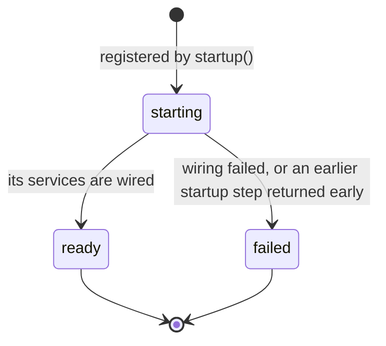
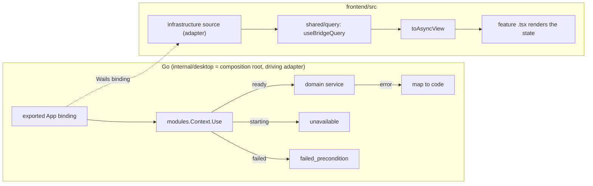
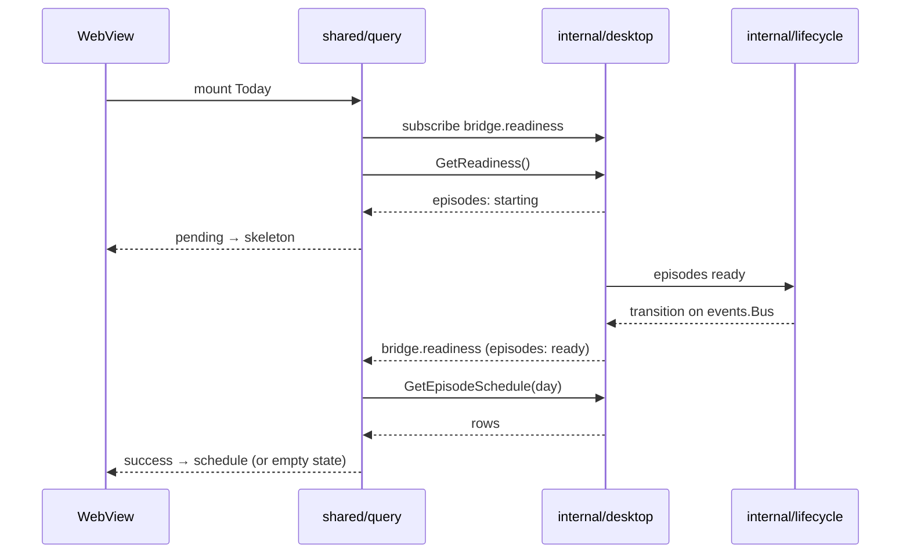

# Async state — readiness, failures and server state

How a value travels from a Go module to a screen, and how "not ready", "failed" and "empty" stay
distinct on the way. The decision and its alternatives are in `docs/adr/032-async-state-standard.md`;
what each state looks like is in `docs/design/patterns/loading-empty-error.md`.

This page covers both sides of the Wails bridge: the Go composition root (`internal/desktop`) and the
frontend layers under `frontend/src`.

## Status

The contract below is being introduced by ADR-032, module by module. Until a module migrates it keeps
its legacy shape; "Known drift" lists what the code does today. When this page and the code disagree,
the code is the runtime truth.

## Module lifecycle

Each module (a bounded context as the desktop shell sees it) has one readiness state in the registry
`internal/lifecycle`. Only the composition root writes it; domains never import it.

- Every transition is published on `events.Bus` and forwarded to the frontend as `bridge.readiness`.
- `GetReadiness()` answers the whole snapshot, so a frontend that subscribed late still learns the state
  (Wails drops events emitted before a listener exists).
- No module stays `starting` forever: an early return in `startup()` marks every module it skips
  `failed` with the reason.
- `ready` and `failed` are terminal: the registry rejects any move out of them
  (`lifecycle.ErrInvalidTransition`). A module never goes back to `starting`.

## Failures and outcomes

| Kind | Values | Travels as | Frontend |
|---|---|---|---|
| Failure | `unavailable` | error (code) | keep the skeleton, retry (bounded) |
| Failure | `failed_precondition` | error (code) | failure Alert with the reason, no retry |
| Failure | `invalid_argument`, `not_found`, `internal` | error (code) | failure Alert (or the field's validation message) |
| Outcome | `applied`, `no_op`, `conflict` | successful result | render the result; a conflict is not an error |

- Domains keep their own sentinel errors. The desktop adapter maps them to codes; the REST adapter will
  add the same codes as an additive field.
- `options.App.ErrorFormatter` serialises a failure as a JSON string (`{"code":"…","message":"…"}`),
  because Wails turns any object into `"[object Object]"`. The frontend adapter treats any message that
  is not that JSON as `internal`.
- `unavailable` and `failed_precondition` come only from a module handle.

## From binding to screen

- **Go.** A binding reaches its service only through its module handle. The `shell` handle carries
  only shell capabilities (effective address, logger, frontend error reporting) and is always ready.
- **Infrastructure** (`frontend/src/infrastructure/**`). The only code that calls bindings or touches
  `window.go`. It turns a rejection into a typed `BridgeError`. It never invents a fallback value.
- **Application** (`frontend/src/shared/query/**`). The only code that imports
  `@tanstack/react-query`. It owns the `QueryClient` defaults, query-key factories per context, the
  event→invalidation bridge and the readiness gate.
- **Features** (`frontend/src/features/**`). Hooks call `useBridgeQuery`/`useBridgeMutation` and
  `toAsyncView`; `.tsx` files render the returned state only.
- **Composition.** One module in `shared/query` constructs the concrete adapters; it is the only shared
  code that imports `infrastructure/**`, which `.dharness/fallow.jsonc` already allows for `shared`.
  The rest of `shared/query` depends on ports. `frontend/src/app/**` only mounts the provider: it may
  import only `features` and `shared`.

## Startup sequence

If the module fails instead, the gate receives `failed` with its reason and the screen shows the failure
Alert; it never shows the empty state.

The subscription and the `GetReadiness()` call race, so the snapshot can be older than an event that
already arrived. Because `ready` and `failed` are terminal, a snapshot that answers `starting` for a
module the gate already saw `ready` or `failed` is stale: the gate keeps the terminal state and never
moves a module back to `starting`.

## QueryClient defaults

| Option | Value | Why |
|---|---|---|
| `networkMode` | `'always'` | the default `'online'` pauses queries on window `offline`; bindings are IPC |
| `refetchOnWindowFocus`, `refetchOnReconnect` | `false` | backend events drive freshness |
| `retry` | only for `unavailable`, bounded | other failures are not transient |
| `placeholderData` | previous data on key change | a day switch keeps rows with `aria-busy` |

## Guidance and gates

Helpers come first; gates only catch what guidance missed. The full table (helper, instructions,
scaffold, gate) is in ADR-032 §5. Instructions live in the skill `bridge-data`, kept identical in
`.claude/skills/` and `.agents/skills/`, and in one line of `CLAUDE.md` and `AGENTS.md`.

Legacy violations sit in an identified-violation baseline. New violations fail in pre-commit; a stale
entry fails in pre-commit (staged) and in `pre-merge-commit` (whole tree), naming the entry to delete.

## Known drift

Measured on `feat/async-state-standard` after the Go foundation (ADR-032 task T2) and the frontend
runtime (task T3a):

- The Go foundation exists: `internal/lifecycle` (registry and writer), `internal/apperr` (codes,
  `error-codes.json`), `internal/modules` (`Handle[S]`, `Shell`), `GetReadiness`, the
  `bridge.readiness` event and the JSON `ErrorFormatter`. Ten modules are registered and settled by
  `startup` (`docs/architecture/contexts/desktop/overview.md`, "Readiness and failures").
- No domain module has a handle yet: every binding except `GetReadiness` still reads an `App` field
  without readiness. `tools/checkarchitecture/baseline.yaml` lists them: 120 `binding-uses-handle` and
  53 `binding-signature` entries (printed by `go run ./tools/checkarchitecture`).
- `GetEpisodeSchedule` and `GetEpisodeDayCounts` return `[]` when the episode service is nil or fails
  (`internal/desktop/app_runtime.go`); the episodes pilot (T4) moves them onto a handle.
- The frontend runtime exists, but no feature uses it yet (the Today pilot, T4, is the first):
  - `@tanstack/react-query` 5.107.1 is installed and imported only under `frontend/src/shared/query/`.
  - `shared/query/query-client/query-client.helpers.ts`: `createBridgeQueryClient` with the defaults
    above; `unavailable` is retried at most 4 times (500, 1000, 2000, 4000 ms).
  - `shared/query/use-bridge-query/use-bridge-query.ts` (`module` option = readiness gate,
    previous data kept on key change), `shared/query/use-bridge-mutation/use-bridge-mutation.ts` (never
    retried), `shared/query/query-keys/query-keys.helpers.ts` (`defineQueryKeys`),
    `shared/query/async-view/async-view.helpers.ts` (`toAsyncView`; only an empty array is empty by
    default, other shapes pass a predicate).
  - `shared/query/readiness-gate/readiness-gate.helpers.ts`: `createReadinessGate` subscribes first,
    then calls the snapshot, and applies the terminal-state rule.
  - `shared/query/invalidation-bridge/invalidation-bridge.helpers.ts`: one registry, mounted once by
    `shared/query/BridgeQueryProvider/BridgeQueryProvider.tsx`; no context registers a rule yet
    (`BRIDGE_INVALIDATIONS` in `shared/query/bridge-runtime/bridge-runtime.constants.ts`).
  - `shared/query/bridge-error/` holds the `BridgeError` contract and its codes;
    `infrastructure/bridge-error/bridge-error.helpers.ts` (`parseBridgeError`, `withBridgeErrors`)
    parses Wails rejections, and its test compares the codes with `internal/apperr/error-codes.json`.
  - `infrastructure/readiness/readiness-source.helpers.ts` is the Wails adapter of the
    `ReadinessSource` port (`shared/contracts/readiness.types.ts`); `createRuntimeEventSource`
    (`infrastructure/wails-bindings.helpers.ts`) is the event adapter.
  - `shared/query/bridge-runtime/bridge-runtime.constants.ts` is the composition module: it builds the
    client, the gate over the readiness adapter, the event adapter and the invalidation registry, and
    is the only `shared/query` file importing `infrastructure/**`.
    `frontend/src/app/BridgeDataProvider/BridgeDataProvider.tsx` only mounts the provider with them; it
    is mounted in `frontend/src/main.tsx` inside `React.StrictMode`.
  - `bun run generate:feature` emits a hook that reads through `useBridgeQuery` + `toAsyncView`, with a
    placeholder loader that rejects until the author wires the binding.
- `invokeGoBinding` (`frontend/src/infrastructure/wails-bindings.helpers.ts`) still answers adapter
  fallbacks such as `() => []` when a binding never attaches, for every source that has not migrated.
- 126 non-test feature files and 15 non-test shared files import `infrastructure/` (grep of import
  specifiers); `shared/query` imports none.
- Server state still lives in 4 Zustand read-models (ADR-006) and in hand-fetching hooks; the ESLint
  gates that confine `@tanstack/react-query`, `infrastructure/**` and `EventsOn` are not in place yet (T3b).
