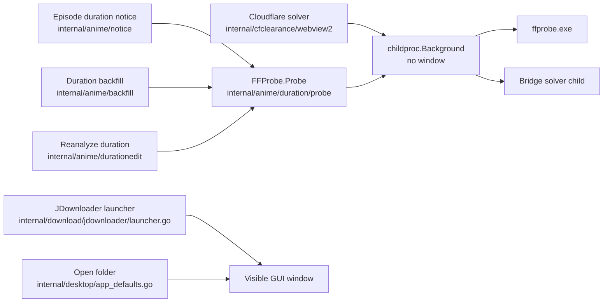

# Child processes

Bridge starts external programs in two very different ways: console programs it runs in the
background to get an answer, and GUI programs it opens for the user to see. This document covers
how each kind is started, why the difference matters on Windows, and the gate that keeps it that
way.

## The problem: a flashing console window

Bridge is a Wails GUI application, built for the Windows GUI subsystem, so it has no console of its
own. When a process without a console starts a console program, Windows creates a new console
window for that program. The window stays open for as long as the program runs and closes when it
exits.

For a background program that runs for under a second, the user sees a black terminal window flash
on screen and disappear before it can be read. Up to release 2.7.0 this happened after every
downloaded episode: the episode duration notice ran `ffprobe` with a plain `os/exec` command, and
a console window flashed right before the UI marked the episode as downloaded.

The program's work was correct; only its window was wrong. The fix does not change what runs, only
how it is started.

## The rule

| Kind of program | Start it with | Window |
|---|---|---|
| Console program run in the background (ffprobe, the Cloudflare solver child) | `childproc.Background` (`internal/childproc/childproc.go`) | None |
| GUI program the user is meant to see (JDownloader, Windows Explorer) | `os/exec` directly, only in the allowlisted files below | The program's own window |
| Tests and developer tools (`tools/`) | `os/exec` directly | Irrelevant: they run from a terminal |

`childproc.Background(ctx, name, args...)` returns an ordinary `*exec.Cmd` built with
`exec.CommandContext`. On Windows, `hideConsole` (`internal/childproc/hide_windows.go`) sets:

- `CreationFlags: CREATE_NO_WINDOW`: the program runs with no console window at all. Its standard
  output and error still work, so `cmd.Output()` reads the result as before.
- `HideWindow: true`: any window the program would still create starts hidden.

On other platforms `hideConsole` does nothing (`hide_other.go`), since no other platform opens a
window for a console child.

A caller may set `Stdout`, `Cancel` or `WaitDelay` on the returned command, but must not replace
`SysProcAttr`: that would bring the window back.

GUI programs must not go through `Background`: `HideWindow` would hide JDownloader's or Explorer's
own window, which is the whole point of launching them.

## Who starts what

| Caller | Program | Started through | When it runs |
|---|---|---|---|
| `internal/anime/notice/coordinator.go` | `ffprobe` | `FFProbe.Probe` → `childproc.Background` | After every downloaded episode is renamed (`internal/download/service_rename.go`) |
| `internal/anime/backfill/measure.go` | `ffprobe` | `FFProbe.Probe` → `childproc.Background` | Once per file during the duration backfill |
| `internal/anime/durationedit/reanalyze.go` | `ffprobe` | `FFProbe.Probe` → `childproc.Background` | When the user reanalyzes an episode's duration |
| `internal/cfclearance/webview2/child_windows.go` | Bridge itself, in solver mode | `childproc.Background`, inside a kill-on-close job object | When a provider request meets a Cloudflare challenge |
| `internal/download/jdownloader/launcher.go` | JDownloader | `os/exec` (allowlisted GUI launch) | When JDownloader is offline and Bridge starts it before talking to it |
| `internal/desktop/app_defaults.go` | `explorer.exe` | `os/exec` (allowlisted GUI launch) | When the user opens a folder |

## Machine owner

`tools/checkarchitecture/childprocess.go` scans every production Go file for the literal
`exec.Command`, which matches both `exec.Command` and `exec.CommandContext`. The literal is allowed
only in:

- `internal/childproc/`, which has to build the command;
- the GUI launch allowlist `guiLaunchFiles`: `internal/download/jdownloader/launcher.go` and
  `internal/desktop/app_defaults.go`;
- `_test.go` files and `tools/`.

Anywhere else the gate fails with
`<path> uses exec.Command: start background console programs with childproc.Background so no console window flashes`.
Like the other architecture rules, it is a raw substring scan, so a comment that spells the literal
also fails it.

`internal/childproc/childproc_windows_test.go` pins the Windows contract: the command carries
`CREATE_NO_WINDOW` and `HideWindow`, and still runs the requested program with its arguments.

## Adding a new external program

1. Console program run for its output or side effect: use `childproc.Background`. Nothing else is
   needed.
2. GUI program the user should see: start it with `os/exec` in one dedicated file, add that file to
   `guiLaunchFiles` with the reason, and list it in the table above in the same change.
3. Never widen the exemption to a whole package or work around it with a different spelling: the
   window flash comes back silently and no test notices it.
