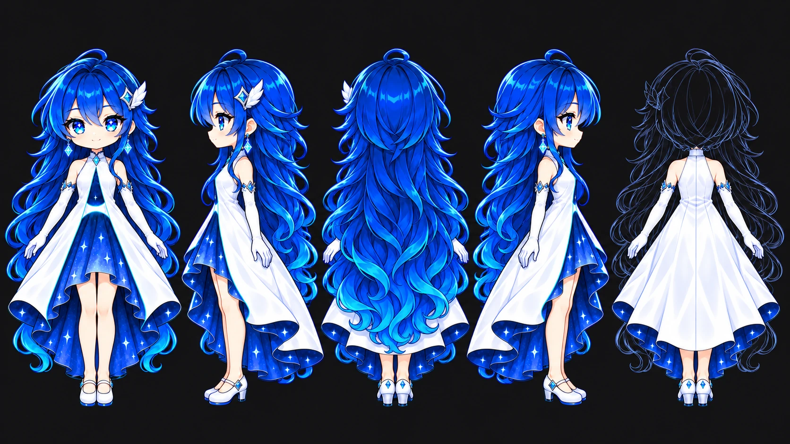

# Airis — character reference

Airis is the assistant mascot shown by `AirisEmptyState`. This document is the
design contract for any new or redrawn Airis artwork. The model sheet is
[`turnaround.webp`](turnaround.webp).



## Reading the model sheet

| # | View | Purpose |
|---|---|---|
| 1 | Front | Canonical design; the dress draws the logo "A" |
| 2 | Left profile | High-low skirts and bell volume; feather clip visible |
| 3 | Back, true | How she really looks from behind: long hair covers the back |
| 4 | Right profile | Feather clip hidden behind the head |
| 5 | Back, costume callout | Hair drawn as a translucent ghost outline **only** to show the back of the dress. She does not have short hair at the back |

The sheet shows a neutral pose without props. Scene artwork adds props per
screen; the character design does not change.

## The dress is the logo

The Bridge logo (`build/appicon.png`, `BrandMark.tsx`) is a white stylised "A"
on blue: rounded apex, two tapered legs, a concave crossbar. The dress encodes
it by figure-ground, not by a printed emblem.

| Logo element | Dress element |
|---|---|
| Apex | High halter collar with a blue diamond at the throat |
| Two legs of the "A" | Edges of the single front opening of the white overdress |
| Blue counter | Deep blue starry inner layer seen through the opening |
| Concave crossbar | White concave waist band with a thin cyan glowing edge |

The white is the brand. Do not tone it down to fit the dark theme; it is the
brightest surface of the figure.

## Construction

Every layer needs a physical reason to hang where it does.

- **Outer layer:** white satin halter overdress wrapping the whole body,
  including the back (clean centre-back seam, bare shoulders). One opening, at
  the front only.
- **Anchor:** the waist band holds both edges of the opening. Below it the
  overskirt parts like curtains.
- **Support:** a hidden tulle petticoat gives the inner skirt a gentle bell;
  the overskirt rests on it and opens to the sides.
- **Inner layer:** one high-low skirt with **one continuous hem** — above the
  knee at the front, ankle length at the back. No stacked tiers, no second
  ruffle.
- **Hem:** the overskirt is high-low too, longest at the back. Its stiffened
  hem curls outward and shows the lining. Wherever the inside of the dress is
  visible, it is deep starry blue.

## Character details

- Chibi proportions; very long voluminous deep blue hair with cyan tips,
  reaching below the skirt hem.
- One white feather hair clip with a blue diamond, on **her left side only**.
- Blue diamond drop earrings.
- Long white opera gloves with small blue diamond cuffs.
- Slender bare legs, matte skin, no glossy highlights.
- White Mary Jane shoes with a **low block heel**, a blue strap and a tiny blue
  diamond.

## Rendering style

- Clean modern anime cel shading: flat base colour, 2–3 hard-edged shadow
  tones, smooth gradients towards the cyan hair tips, a glossy highlight band
  on the crown.
- No painterly texture, brush noise or mottled patterns in the shadows.
- Glows are cyan and stay close to their source.

## Empty-state asset rules

- Files live in `frontend/src/assets/airis-empty-states/` and must pass
  `bun --cwd="frontend" run check:airis-assets`: WebP, exactly 512x512, with a
  transparent background.
- The artwork renders at 160 px (`AIRIS_ARTWORK_CLASS`) and 40 px (compact).
  Check both sizes on the dark card surface (`#18181b`) and on a light surface
  before shipping.
- Keep the surroundings sparse: two or three props that name the screen, a few
  sparkles. Complexity goes into the costume and light, not into more objects.

## Generating artwork

- Generate with a fully transparent background requested in the prompt and PNG
  output, then convert to 512x512 WebP. Do not remove a chroma-key background
  locally: despill turns the cyan glows grey.
- Convert in two steps and check that the background is still alpha 0:

  ```bash
  ffmpeg -i source.png -vf "scale=512:512:flags=area" -c:v png scene-512.png
  ffmpeg -i scene-512.png -vf format=yuva420p -c:v libwebp -quality 90 scene.webp
  ```

  A single-pass conversion with `-compression_level 6` left the background at
  alpha 1–39, which shows as a faint square on a light surface while still
  passing `check:airis-assets`.
- State the construction and rendering style in every prompt. Chained edits
  drift and accumulate texture; restart from the model sheet when they do.
- Turnaround generators mirror profiles. Say on which side each asymmetric
  accessory is visible in every view.
