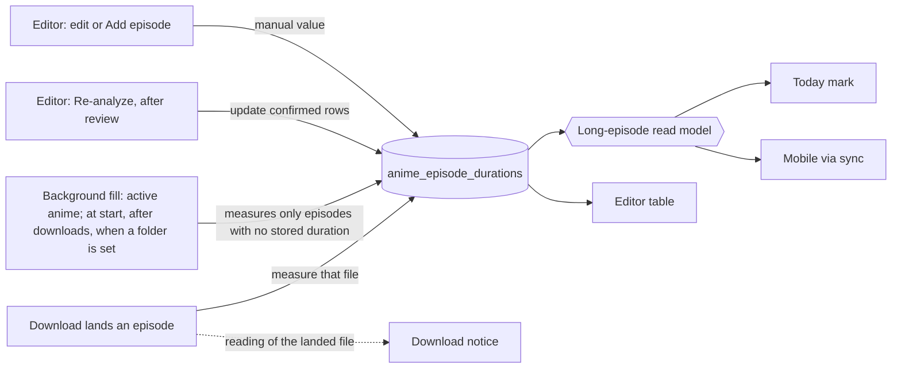
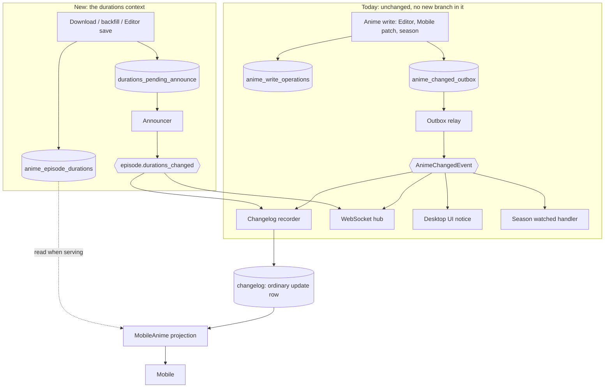
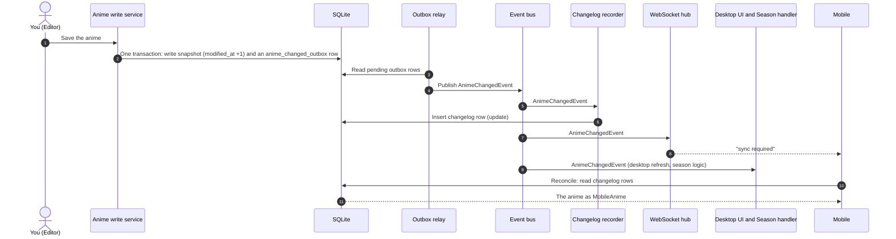
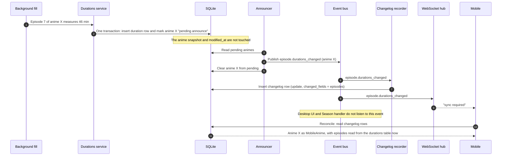

# Episode Durations — Analysis

**Status:** analysis closed on 2026-10-13. Decisions D0–D7 are decided or verified against the code. This is the
reference for the ODD work units in [`odd/tasks/episode-durations.md`](../odd/tasks/episode-durations.md).

**Note (2026-10-26):** the `anime_write_operations` and `anime_changed_outbox` tables and the outbox relay this
analysis describes no longer exist. An anime save is now one transaction that writes the snapshot and its changelog
row; the duration announcement path (D6) is unchanged.

**Related:**

- Editor UI design guide: [`episode-durations-editor-ui.md`](episode-durations-editor-ui.md), and the approved canvas
  "Editor — Episode metadata" <https://claude.ai/artifact/Dt1pS5Yn3E5KUwgMbJK95i>.
- The interactive version of this analysis: <https://claude.ai/artifact/2r9WEWGAEq4JCG5z6XsfJp>.
- The feature this builds on: [`episode-duration-notice.md`](episode-duration-notice.md).

Bridge stops treating an episode's runtime as something to recompute from the disk on every read, and starts keeping it
as data about the episode, the way a streaming catalog does. This document covers how that data is stored, when it is
measured, who reads it, and how it reaches Mobile.

## 0. Starting point

- **Already shipped:** the Episode Duration Notice. It computes a "long next episode" mark for Today and a notification
  when a long episode finishes downloading, both by running ffprobe when they are used. Nothing is stored.
- **Decided:** durations become stored domain data keyed by anime and episode number. No file paths, file IDs or file
  timestamps are stored; the folder belongs to the user.
- **Approved:** the Editor UI for viewing, re-analysing and correcting durations.
- **Fixed by the user:** Today and the download notice keep their behaviour. Mobile is one more consumer. Bridge
  builds its side first, then Mobile is told the contract.
- **Measured on the real database (2026-10-13):** 15 active anime, 2–3 per day, 231 episode files in their folders.
  Listing those 15 folders with Go `os.ReadDir` takes 0.5–0.7 ms. In a sample of 10 inactive anime, none of the folders
  existed any more.

## 1. Code facts this analysis rests on

Read from the code on `feat/episode-durations` (branched from `dev` at `a1aea330`) with CodeGraph.

| Fact | Consequence | Evidence |
|---|---|---|
| No numbered migrations. Each context declares `SchemaTables()`, and the schema is ensured on every start. | A new table is one descriptor plus one registration line. No migration of existing data. | `internal/persistence/schema.go:25-86`, `internal/sync/sqlite_bootstrap.go:165-187` |
| `watch_history` is an anime-keyed, per-episode table with a natural-key unique index. | It is the pattern to copy, including its architecture ownership rule. | `internal/watchhistory/schema.go:11-50`, `tools/checkarchitecture/main.go:23-34` |
| Restore points are a whole-database `VACUUM INTO` copy. | A new table is included in restore points automatically. | `internal/sync/restore_point.go:23-33` |
| Backup export and import use an explicit list of groups, guarded by a footprint test. | The table is **not** in exported backups unless a group is added to both lists and to the test. | `internal/desktop/app_backup.go:61-67`, `app_backup_import.go:35-43`, `app_backup_import_footprint_test.go:28-34` |
| The backup import of `anime_snapshots` is a full refresh. | The durations group follows the same semantics. | `internal/sync/backup_import.go:96` |
| Bridge only soft-deletes anime (`SoftDeleteAnime`, undone by `RestoreAnime`). `AnimeChangeTypeDelete` and `ReplaceBaseline` pruning are used only in tests. | Durations are never deleted with an anime. | `internal/anime/episode_service_schedule_state.go:130-166`, `internal/sync/anime_snapshot_store.go:63-104` |
| `anime_changed_outbox.operation_id` is `NOT NULL UNIQUE`, with a foreign key to `anime_write_operations`. | That outbox belongs to anime writes and cannot carry a duration announcement. | `internal/sync/schema.go:145-155`, `internal/sync/write_base_finalize.go:31-53` |
| `AnimeChangedEvent` has four production subscribers: the changelog recorder, the WebSocket hub, the desktop UI notice, and the season watched handler. | Reusing it for durations would re-run season logic and desktop refreshes for nothing. | `internal/sync/changelog_recorder.go:39`, `internal/desktop/app_runtime_services.go:224`, `app_startup_runtime.go:364`, `app_season_availability.go:202` |
| A changelog row stores the snapshot JSON as it was when the event fired. `toAnimeChanges` projects that stored copy. | Durations must be added when serving, not when the row is written. | `internal/sync/service.go:222-259` |
| `identity.Identify` exposes only the next episode. The per-file assignments are internal. | Re-analysing a whole folder needs a new exported function. | `internal/anime/identity/port.go:124-135`, `resolve.go:10-53` |
| Half episodes are reported as `ambiguity` with detail `fractional`, and contested numbers as `duplicate`. | These map directly to the "Skipped" results in the approved review modal. | `internal/anime/identity/port.go:24-58`, `parse.go:55-57` |
| ffprobe has a 30 s timeout per file, and any failure is "unavailable". Long means over 30 min. | Measurement can fail silently and must never erase data. | `internal/anime/duration/probe/probe.go:29-131`, `duration.go:18-68` |
| The anime already has a nominal `durationMinutes`, one value per anime from MyAnimeList or the Editor's "Duration" field. | These are two different facts. The new data is per episode and never overwrites the nominal value. | `internal/anime/domain/anime.go:63`, `internal/anime/store/editor_mutation.go:94` |
| The download scheduler has an injected `Clock`/`Timer` seam. Bridge has no resume-from-sleep detection. | Not used, because there is no periodic job (D5). | `internal/schedule/scheduler_contracts.go:11-25` |

## 2. Storage

**Decided (D0): one duration per episode, plus who wrote that value.** What matters is that the value is true. `source`
records only who set the *current* value. It is overwritten together with that value and is never a history. One value
keeps the code that processes it free of "which one wins" conditions, and `source` lets the approved UI keep showing
"Manual" and "Manual kept".

```sql
CREATE TABLE anime_episode_durations (
  anime_id       TEXT    NOT NULL,
  episode        INTEGER NOT NULL CHECK (episode >= 1),
  duration_ms    INTEGER NOT NULL CHECK (duration_ms > 0),
  source         TEXT    NOT NULL CHECK (source IN ('measured', 'manual')),
  updated_at_ms  INTEGER NOT NULL,
  PRIMARY KEY (anime_id, episode)
);
-- automatic paths:           INSERT ... ON CONFLICT (anime_id, episode) DO NOTHING
-- manual edit / Add episode: upsert with source = 'manual'
-- confirmed re-analysis:     upsert with source = 'measured', only rows whose source is not 'manual'
```

- **Milliseconds:** ffprobe returns fractional seconds. Storing whole minutes would make the 30-minute boundary depend
  on rounding at write time. The UI and Mobile round to minutes when they display.
- **No cycle column:** `watch_history` is keyed by cycle because a rewatch is a new viewing. An episode's runtime does not
  change on a rewatch.
- **Only rows with a value:** "Not measured" rows in the Editor are derived from Total episodes and the files found. They
  are never stored.
- **Whole episodes only:** half episodes stay out of v1. `INTEGER` and the check make that a schema guarantee.

### Cases from the UI and how storage answers them

| Case | What is stored |
|---|---|
| An episode lands and is measured | Insert only if the episode has no row. An existing value is never overwritten (D3). |
| The user edits a duration | Overwrite `duration_ms`, `source = 'manual'`. |
| The user adds an episode with no file yet | Insert with `source = 'manual'`. When the file arrives, the download path sees a row and leaves it alone. |
| Re-analysis confirms changes | Overwrite the differing rows whose source is `measured`. Manual rows show as "Manual kept" and are not touched. |
| The folder disappears (finished anime) | Nothing changes. Durations outlive the folder. |
| Analysis fails, stops halfway, or skips files | Nothing is deleted or overwritten for episodes it did not measure. |
| "Clear duration" in the edit modal | Delete the row. If the file is still there, the next backfill or re-analysis measures it again (D1). |
| The anime is deactivated (`activo=false`) or soft-deleted | Nothing changes. `RestoreAnime` brings it back with its durations (D2). |
| A backup is imported | The `episode_durations` group is replaced from the bundle, like `anime_snapshots` (D2). |

### Backups

- **Restore points** include the table automatically through the whole-database copy.
- **Export/import bundle:** add an `episode_durations` group to both lists, with `Export`, `Validate` and `Import` in the
  owning package, and an entry in `declaredImportGroupFootprints`. The import does a full refresh, like `anime_snapshots`.
- **Older bundles** have no such group. They import as they do today, and durations refill from measurement. Nothing is
  lost, because no older bundle contains durations.

## 3. Measurement: where and when

An episode's runtime does not change. A different reading for the same episode means a different file was assigned to
it, not that the episode changed. So automatic paths only **fill gaps**, and only the Editor's re-analysis, through a
review the user confirms, may **change** a stored value.



| Point | Trigger | Measures | May overwrite? | Status |
|---|---|---|---|---|
| Download landed | `EpisodeLanded`, which already probes the file | The landed file | No (D3) | Exists; add the write |
| Today read | Opening Today | Nothing. Today only reads the table (D7). | n/a | Probing removed |
| Backfill | Process start and after each download run (D5). Anime edits trigger nothing. | Every recognised file of active anime with no row | No | New, required by D7 |
| Editor re-analysis | The user presses the button | Every recognised file in the folder | Yes, after the review, never a manual value | New |

### Backfill (D5)

The backfill is required by D7: it is the only way episodes downloaded before this feature get a duration, and Mobile
depends on it to stay correct offline. It runs in the background, for active anime only, on two triggers:

1. **Process start:** one pass. It covers the first run after installing the feature and every restart.
2. **After each download run:** only the anime that run touched.

Anime edits trigger nothing (revised 2026-10-14): a duration does not change with the folder, so creating an anime, restoring it or editing its Folder measures nothing until the next start, a download, or "Re-analyze folder" in the Editor.

There is no periodic timer. The only case one would cover is a file dropped into a folder by hand. Bridge usually runs in
the background but normally restarts once a day, so that file waits at most until the next start, a download of that
anime, or a re-analysis.

Shared rules: one pass runs at a time, and a trigger that arrives during a pass queues one repeat. The pass is skipped
silently when ffprobe is missing. A pass announces each anime it changed once (section 5). It probes at most 2 files
at a time, which is deliberately gentle because Bridge runs other background work on the same machine. The first pass
costs about 231 files × 64–86 ms ÷ 2, roughly 10 seconds; after that it only measures new gaps. ffprobe never runs
inside a database transaction: with `SetMaxOpenConns(1)`, a transaction held open while probing would block every other
Bridge query.

### Rules every measurement path shares

- **Confidence gate:** store a reading only when identity assigned the file without ambiguity or duplicate. This is the
  same gate Today uses now.
- **All anime types are measured.** The TV-only gate moves from measurement to the long mark, matching the approved UI.
- **A failure writes nothing.** Missing ffprobe, a timeout or an unreadable file leaves existing rows as they are.
- **Re-analysis needs a new identity function** that returns every confidently assigned `(episode, file)` pair, plus the
  skipped files with their reason.

## 4. Consumers

- **Today — same output, no probing (D7).** It still returns `LongNextEpisode {episode, minutes}`, now read from the
  table through the shared read model. It no longer reads the folder, runs identity or starts ffprobe when it opens. An
  episode added by hand before its file exists can now be marked, because the lookup is by number. With files present the
  episode is the same as before, since identity already expects *progress + 1* (`identity/port.go:115`). The probing code
  in `internal/anime/notice/today.go` is removed.
- **Download notice — same behaviour.** It still notifies when a landed episode runs long, using the file it just
  measured. It now also stores that reading when the episode has no row yet.
- **Editor — new.** It reads and writes durations per the approved UI. Edits join the Editor draft and are saved with
  **Save**.
- **Mobile — new.** It receives the durations inside each anime and shows the mark for *nrocapvisto + 1*. That is a
  lookup, not a calculation: Bridge sends whether each episode is long.

### One read model for Today and Mobile

Today and Mobile answer the same question, so one pure function in the anime context answers it for both. Each consumer
has a thin adapter onto its own contract:

```go
// anime: pure, no I/O, the only place the long rule is applied
func EpisodeLengths(durations []EpisodeDuration, kind *int) []EpisodeLength                    // {Episode, Minutes, Long}
func LongNextEpisode(durations []EpisodeDuration, kind *int, progress float64) *notice.Mark

// adapters
// Today  (Wails binding): EpisodeScheduleItem.LongNextEpisode = LongNextEpisode(...)
// Mobile (projection):    MobileAnime.Episodes                = EpisodeLengths(...)
```

- **Long** means TV type and over 30 minutes (`duration.Classify`). It is decided only here, so Today and Mobile cannot
  disagree.
- **Next** means episode *progress + 1* for whole-number progress. Fractional progress gives no mark, as today.
- Today loads the durations of the day's anime in one query.

## 5. Sync to Mobile

Mobile already receives each anime through `GET /api/animes` and the reconcile changelog, as a `MobileAnime`
projection. The durations ride in that projection as an optional field:

```json
"episodes": [
  { "episode": 1, "minutes": 47, "long": true },
  { "episode": 2, "minutes": 24, "long": false }
]
```

Only episodes with a stored duration are listed, and the field is omitted when there are none. `long` is decided by
Bridge, so Mobile computes nothing.

### How Mobile learns that a duration changed

Mobile only hears about an anime when a row appears in the changelog, and today a row appears only when the anime is
saved. Durations live in their own table, so without new work a backfill that measures episode 5 would never reach Mobile.

**Option A, rejected: store durations inside the anime snapshot.** Every measurement would become an anime write and bump
`modified_at`, the version Mobile sends back with its offline edits. Example: offline, you mark episode 6 watched on the
phone; meanwhile Bridge measures episode 7 in the background and bumps the version; when the phone syncs, your edit is
rejected as a conflict although nobody else touched your progress.

**Option B, decided (D6): separate table, own event, same changelog row.** In other words, the episode update is not
part of the anime's data or of the anime's event. It is its own event inside Bridge. For Mobile nothing is new: it gets
the usual "anime updated" row, with `episodes` inside the anime.

### Components



### Sequence 1 — today, unchanged: you edit an anime



### Sequence 2 — new: the background fill measures episode 7



If Bridge stops between steps 2 and 4, anime X stays marked as pending and the announcer sends it at the next start.
That is why the pending mark is saved in the same transaction as the duration.

### Why not reuse `AnimeChangedEvent`

- **The outbox belongs to anime writes.** Every `anime_changed_outbox` row must point to an `anime_write_operations`
  row. Announcing durations through it would mean inventing a fake write operation.
- **The event has four consumers.** Besides the changelog, the season handler runs `HandleAnimeWatched` from the payload,
  so an unchanged snapshot would re-run season logic for nothing.
- **So the existing rule stays intact:** `AnimeChangedEvent` still means "the anime was written". Durations have their
  own event, and only the two components that must react to it opt in.

### What is added, and nothing else

- **Durations context:** the table, plus `durations_pending_announce(anime_id PRIMARY KEY)` upserted *in the same
  transaction* as a duration write. A small announcer publishes `episode.durations_changed` for each pending anime and
  deletes the row. It runs after each write and at start. The primary key gives the grouping for free: one announcement
  per anime, however many episodes changed.
- **Changelog recorder:** a second subscription that writes the same `update` row an edit writes, with
  `changed_fields = ["episodes"]` and the current snapshot.
- **WebSocket hub:** a second subscription, so a connected phone is told to sync.
- **Projection:** durations are added to `MobileAnime` when serving, in `toAnimeChanges` and in `GET /api/animes`.
- **Guard tests:** an anime edit produces exactly the same outbox, event and changelog row as before. Saving durations
  publishes no `AnimeChangedEvent` and does not move `modified_at`.

### Order of delivery

1. Bridge: the table, measurement, the Editor, the projection field, and the announcement path.
2. Bridge: `docs/openapi.yaml` documents the optional `episodes` field on the anime schema.
3. Mobile is told the contract and decides its own storage.

## 6. Decisions

| ID | Question | Outcome |
|---|---|---|
| D0 | One value per episode, or measured and manual kept apart? | **Decided.** One value plus `source` (writer of the current value, never a history). Automatic paths only fill gaps. |
| D1 | What does "Clear duration" do? | **Decided.** It deletes the row, which is measured again if the file is still there. |
| D2 | What happens to durations on a soft delete or a backup import? | **Resolved by evidence.** Bridge only soft-deletes, so durations stay. A backup import replaces them from the bundle, like `anime_snapshots`. |
| D3 | A download lands a file for an episode that already has a value. Overwrite it? | **Decided.** No. A different reading is corrected through re-analysis. |
| D4 | Accept the UI change D0 implies? | **Decided.** Yes. The edit modal shows the current source ("Measured from the file" / "Set by hand") instead of "Last measured". Applied to the canvas and the UI spec. |
| D5 | When does the backfill run? | **Decided.** At process start and after each download run. No periodic timer. Revised 2026-10-14: a folder change, creation or activation triggers nothing, since a duration does not change with the folder; "Re-analyze folder" measures on demand. |
| D6 | How does Mobile learn about duration changes? | **Verified.** Option B: own event `episode.durations_changed` with its own pending table. `AnimeChangedEvent` and the anime outbox stay untouched. Durations are joined when serving. |
| D7 | Does Today read only the table, with no probing when it opens? | **Decided.** Yes. Cost: a file dropped into a folder by hand gets no mark until the next start (normally within a day), a download of that anime, or a re-analysis. |

Out of scope for v1: half episodes (x.5). They are reported as skipped and never stored.
