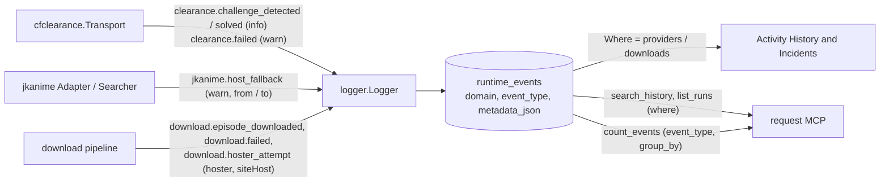

# Activity UI: findings and requirements

The Activity screen (`frontend/src/features/network`) is the only screen that reads debug capture. Users
avoid it because it can hang the app. This page records why it hangs, and the requirements a redesign
built for the new architecture must meet.

## Why it hangs today (measured 2026-10-17)

| # | Hazard | Evidence | Severity |
|---|---|---|---|
| H1 | Opening one request reads **every** capture row with its bodies (about 5,066 rows, 9 MB+), and keeps one | `internal/observability/requestcapture/reader_search.go` `Reader.Get` has no `WHERE request_id = ?` | freeze |
| H1b | That read holds the only SQLite connection, so sync and every other screen wait behind it | `internal/sync/sqlite_bootstrap.go` `SetMaxOpenConns(1)` | freeze |
| H1c | It runs on every selection change and on every live update of the selected row; arrowing through rows queues one full read per key press | `TransactionPanel/use-transaction-panel-sync.ts` | freeze |
| H2 | An empty selection is sent as the id `"undefined"`; virtual spacer rows are selectable | `TransactionTable.tsx`, `NetworkTable.tsx` `onSelectionChange` | freeze (via H1) |
| H3 | Disabled skeleton rows inside a React Aria table, the class fixed for the other tabs in 1.14.0 | `ActivityOverview/ActivityOverviewSkeletonRows.tsx` | hang, no error |
| H4 | The Runtime Events live overlay has no cap and is rebuilt in O(n) per event | `network-store.helpers.ts` `prependOverlay`, `network-feed.helpers.ts` `mergeEventFeed` | slows over hours |
| H5 | A 64 KB JSON body is parsed three times and rendered as one large text node | `shared/ui/CodeBlock` | jank |
| H6 | Thousands of identical polling rows fill the list | Transactions list | clutter |

Already bounded, so these are not causes: list endpoints (summary projection, no bodies, 100 rows), both
rails (virtualized, overscan 5), polling (only filter debounce), and row re-rendering (memoized).

## Hard requirements for the new UI

Each requirement has a test that fails when the guard is removed.

1. **One row per detail.** Opening an item reads it by primary key. A Go test pins the query.
2. **Bodies on demand.** The detail shows the first lines. The full body opens in a viewer that renders only
   the visible lines, and parsing runs off the render path.
3. **Bounded live memory.** A live list keeps at most 500 rows. Older rows come from History through a
   cursor. A test pushes 10,000 events and checks the cap holds.
4. **Bounded DOM.** Every list renders one progressive batch (ADR-012). A DOM-count test proves it.
5. **No disabled or spacer items inside React Aria collections.** Placeholders render outside the
   collection, and selection ignores empty picks.
6. **Polling is folded.** Repeated identical calls collapse into one row per route per hour, expandable on
   demand.
7. **No full scans on the UI path.** Summaries read the rollup, not raw rows.
8. **Real-app proof.** Before delivery, Activity opens in the real WebView against a copy of the owner's
   data, and frame times are recorded.

## UX brief

The questions Activity must answer, taken from the 92 resolved issues:

| Question | Typical issue | Source |
|---|---|---|
| Is everything fine right now? | "the phone looks frozen" | rollup, last contact, open incidents |
| What went wrong, and is it new? | reconcile cascade at 17:31 | incidents, by fingerprint |
| What happened around that moment? | the error cause, what ran at the same time | incident window |
| Did my change reach the bridge? | an edit erased scheduled days | write journal |
| What did the bridge answer the phone? | the cursor reset to 0 | response versions |
| When did it stop, and for how long? | the phone was silent for 43 h | rollup, lifecycle |
| What did the phone see? | late sync-cycle reports | mobile reports |
| What did the bridge do inside, step by step? | a hoster declared dead, a stranded editor write | event ledger with metadata, grouped by correlation id (a download run, an editor save) |

Internal bridge work is a first-class source, not an API detail. Incidents and History filter by where
something happened: phone and sync, downloads, editor, schedule or season. The backend and the request
MCP also accept `providers`, the Cloudflare clearance (`clearance.*`) and jkanime host fallback
(`jkanime.host_fallback`) events, which the screen shows under All. An internal story reads its
steps from one correlation id and shows its metadata as labelled fields, with the raw JSON one click
away.

The request MCP also answers "how many?" without a screen: `count_events` counts the events of one
`event_type` over whole local days of the 90-day ledger (default all 90), optionally grouped by one
top-level metadata key, so `download.episode_downloaded` grouped by `siteHost` returns how many
episodes each site host served. Events without the key, or whose metadata was stored truncated, form
the group whose value is `null`. The key is validated and bound as a JSON path parameter.

A bus `Publish` alone reaches neither box on the right: only a row written through `logger.Logger` does.

Decision (owner, 2026-10-17): **only errors open an incident.** A warning that recovers on its own appears
in History with a "Recovered" mark. In the measured week the bridge logged 10 warnings and 0 errors, so
opening an incident for every warning would mostly raise false alarms.

Design principles, agreed with the owner:

- **Simple and beautiful.** Simple is not enough: the screen must look designed, not merely functional.
- **Answer first, detail on demand.** The first screen answers "is it fine?". Raw rows are one step deeper.
- **Calm by default.** Healthy is quiet. Color is spent only on what needs attention.
- **Honest about gaps.** Missing data is shown as missing, never as "nothing happened".
- **Built from the design system.** HeroUI v3 components and semantic tokens (`autoreas-theme`), with
  loading, empty and error states drawn.

Earlier concepts are in the canvas "Activity Debugger Concepts" (v1–v9). They were redesigns of the
current screen. The new UI starts from this brief instead.
